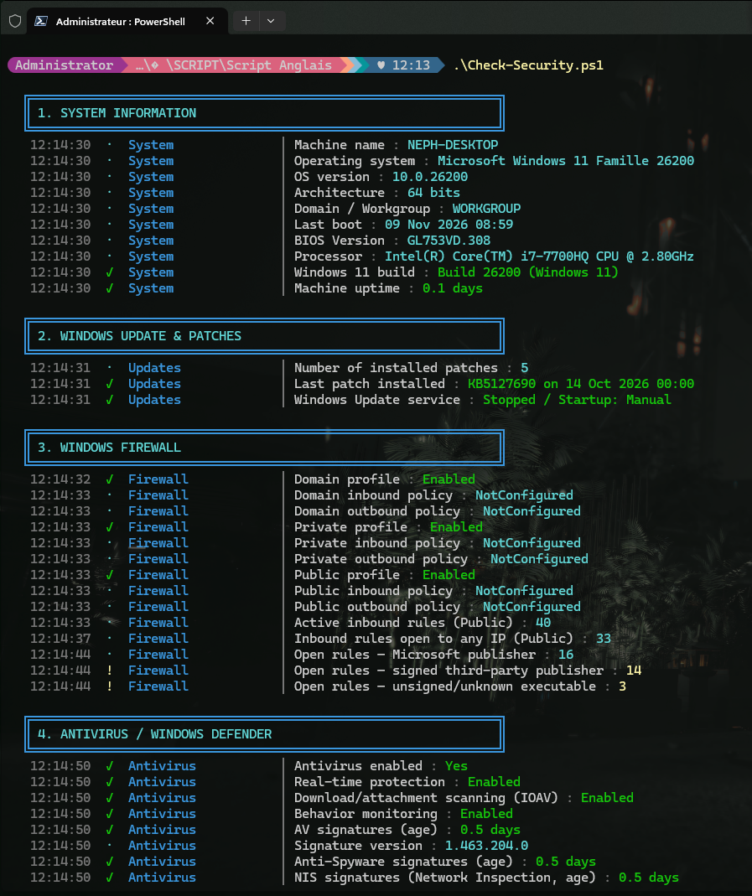
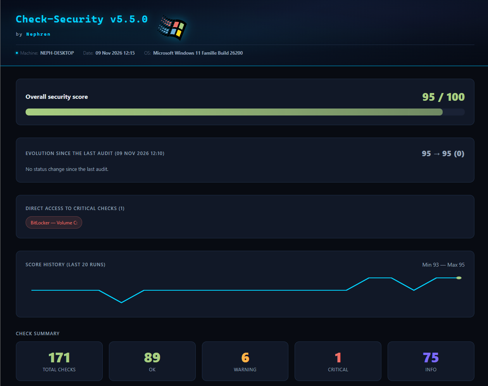
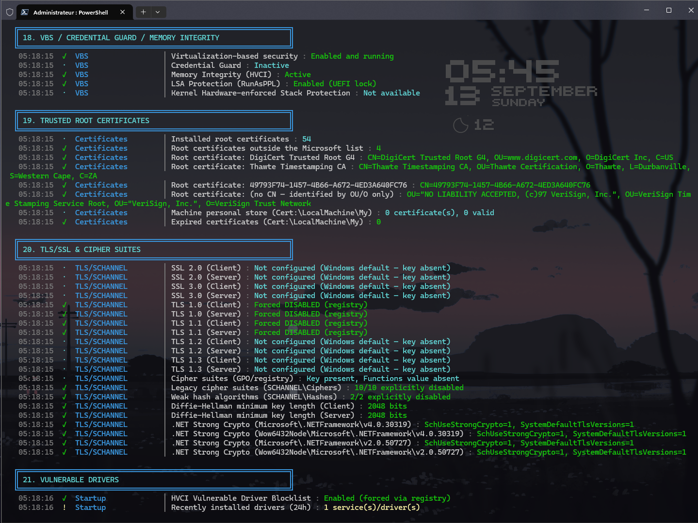
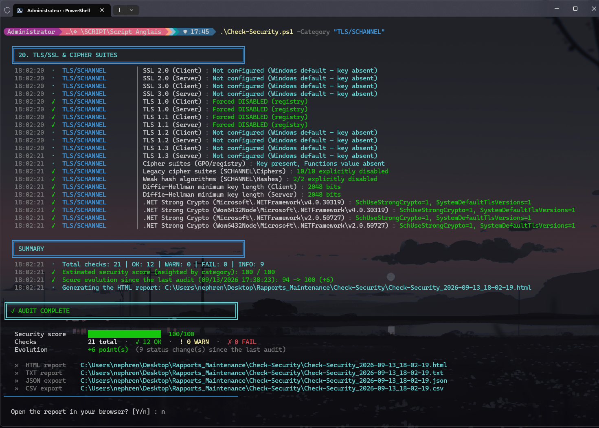

# Check-Security

🇫🇷 [Version française](README_FRENCH.md)

A comprehensive, non-invasive security audit for Windows 11 — 27 sections covering everything from Windows Update status to TLS cipher suites and remote-access exposure, scored with a category-weighted model, tracked over time, and rendered as a searchable HTML dashboard. Read-only: every check inspects system state, none of them change it.

> Nothing is checked against a name. Trusted root certificates are validated by SHA-1/SHA-256 thumbprint against a manually-verified allowlist — never by their Subject CN, which any malicious self-signed certificate could copy. The score model itself was rebuilt once already after the original version produced a 1/100 score on a genuinely well-hardened machine.

As of **v5.1.0**, the script's own console output, HTML/TXT/JSON/CSV reports, category names, and `-Category` values are all in English. A handful of checks whose *input* is Windows itself — `auditpol`, `wbadmin` — parse both the English and French wording those commands can return, so the script keeps working correctly on French-language Windows installs too, not just English ones. Shadow copies no longer depend on text parsing at all: since **v5.4.2** they are read through CIM (`Win32_ShadowCopy` / `Win32_ShadowStorage`), which is language-independent — `vssadmin` is kept only as a fallback.

---

## Table of contents

- [Overview](#overview)
- [Screenshots](#screenshots)
- [How the score works](#how-the-score-works)
- [The 27 sections](#the-27-sections)
- [History and regression detection](#history-and-regression-detection)
- [Using the `-Category` filter](#using-the--category-filter)
- [Prerequisites](#prerequisites)
- [First run](#first-run-step-by-step)
- [Command-line parameters](#command-line-parameters)
- [Generated reports](#generated-reports)
- [Multi-machine deployment](#multi-machine-deployment)
- [Troubleshooting](#troubleshooting)

---

## Overview

`Check-Security.ps1` runs a single-pass audit of a Windows 11 machine's security posture: Windows Update status, firewall, Defender, account/password policy, BitLocker, network protocol exposure, scheduled tasks, startup programs, VBS/Credential Guard/HVCI, TLS/cipher configuration, certificate trust store, ransomware resilience (Shadow Copy/VSS), legacy name resolution and IPv6 tunnels, Defender protections, PowerShell 2.0, remote-access services, stored credentials, and more — 27 sections in total.

It is entirely **read-only**. No check modifies a setting, stops a service, or writes to the registry outside of its own report/history files — it only reads and reports.

Since v5.5.0, findings on the newest checks end with a hint naming the matching command of the separate **Toolbox-SystemCommands** launcher (for example *Fix with Toolbox-SystemCommands > Quick security > 'Disable PowerShell 2.0'*). Check-Security itself still never fixes anything: it detects, the Toolbox fixes. The hints can be switched off with `$ShowToolboxHints`.

Each finding is recorded with a category, a status (`OK` / `WARN` / `FAIL` / `INFO`), and a plain-language detail. These roll up into a single **weighted score out of 100**, and every run is compared against the previous one to surface what changed.

---

## Screenshots

<p align="center">
  
  
</p>

More in [`screenshots/`](screenshots/) — console output, section-by-section, and the full HTML report.

---

## How the score works

The scoring model went through a documented rewrite (v4.1) after the original "100 − sum of penalties" approach produced a 1/100 score on a machine that actually had HVCI, LSA Protection, Secure Boot, and 18 ASR rules active — penalties stacked without limit as more checks were added, regardless of overall posture.

The current model is a **category-weighted success rate**:

```
For each category C:
    OK / INFO → 1.0   (fully passed)
    WARN      → 0.5   (half credit)
    FAIL      → 0.0   (failed)
    rate(C) = average of the above over every check in that category

Score = Σ(weight(C) × rate(C)) / Σ(weight(C)) × 100
```

This is invariant to how many checks exist in each category, and one `FAIL` in a small category can no longer sink the whole score the way it did under the old model.

**Category weights** (categories not listed default to 1.0):

| Category | Weight | Category | Weight |
|---|---|---|---|
| Antivirus | 1.6 | Certificates | 1.3 |
| BitLocker | 1.6 | Firewall | 1.4 |
| VBS | 1.5 | Network | 1.4 |
| Backup | 1.5 | TLS/SCHANNEL | 1.4 |
| Password Policy | 1.3 | Hardening | 1.4 |
| Accounts | 1.2 | Defender | 1.1 |
| Services | 0.8 | Startup | 0.7 |
| Software | 0.5 | | |

The intent: a `FAIL` on BitLocker or antivirus should hurt more than a `FAIL` on "installed software" — the weights encode that judgment explicitly rather than leaving every check equally important by accident.

---

## The 27 sections

<details>
<summary><strong>1–5 · System, Windows Update, Firewall, Defender, Accounts</strong></summary>

System info + Authenticode signature of the script itself; last patch age (WARN >30 days, FAIL >60); per-profile firewall status and rule classification by publisher (Microsoft-signed → INFO, third-party/unsigned → WARN); Defender real-time protection, last scan age (WARN >7 days, FAIL >30), 30-day threat detection history; local accounts, password policy, and the built-in Administrator (RID-500) account specifically.
</details>

### Password Policy, in more detail

**This checks the local policy Windows would enforce on a *future* password change — not your current password.** `Minimum length required by local policy: 0 characters` (the Windows out-of-box default) doesn't mean your actual password is 0 characters, or that anything about it is weak — it means that if this account's password were changed tomorrow, Windows wouldn't enforce any minimum at all. You can have a strong, long password in place right now despite a permissive policy here; the script says so explicitly in each result's detail text.

| Check | What it reports |
|---|---|
| **Minimum length** | `WARN` below 12 characters — see below for why |
| **Maximum / minimum password age** | Informational — how often Windows would force a change, and the minimum delay before changing again |
| **Lockout threshold** | `WARN` if disabled (`0` attempts) — no automatic lockout after repeated failed sign-ins |
| **Lockout duration** | `WARN` if configured at under 5 minutes — too short to effectively blunt rapid brute-force bursts |

**Why 12 characters, specifically?** That's current mainstream guidance (NIST SP 800-63B, CISA, ANSSI) — the older "8 characters" standard dates from when offline cracking was far slower. On modern GPU hardware, an 8-character NTLM hash — complex or not — can fall to brute force in hours; every additional character multiplies the search space by roughly 95 (the printable ASCII range). 12 is roughly the point where even a sustained offline attack stops being economically worth it, which is why the general trend (NIST included) has shifted from "mandatory complexity" to "length first."

If you want to raise it: `net accounts /minpwlen:12` (adjust the number to taste). This is a policy setting, not a fix for anything actively broken — treat a `WARN` here as a recommendation, not an error.

**Local accounts and their password flags.** Each local account line ends with `Pwd expires: …`. `Never` means the account has a password that never expires (`WARN`, a hardening recommendation: current guidance such as NIST SP 800-63B no longer asks for forced rotation, so it is a choice you can make knowingly); `Yes` means it expires; `n/a (no password set)` is a built-in account that never had a password (Administrator, Guest, DefaultAccount); `Managed online` is an account linked to a Microsoft or Entra ID account, whose password is managed online. Separately, an enabled local account whose SAM flag says *password not required* gets a `WARN`: the flag does not prove the password is empty, it means Windows would *allow* an empty one, and the script cannot test it without producing a failed sign-in (which would count toward your lockout threshold). If the account does have a password, clear the flag with `net user <name> /passwordreq:yes` (set a password first if it has none, otherwise you could no longer sign in).

<details>
<summary><strong>6–10 · UAC, BitLocker, Network, Services, Audit logs</strong></summary>

UAC level; BitLocker (system drive `C:` → FAIL if off, other volumes → WARN); listening ports classified by exposure (RDP on `0.0.0.0` → FAIL, WinRM → strong WARN, RPC 135/SMB 445 on system interfaces → INFO since that's normal Windows behavior), established TCP connections to public IPs enriched with process name, IPv6 firewall exposure, active network profile per interface; non-system auto-start services with suspicious paths; audit policy configuration and recent security events (4648 explicit-credential logons, 4720/4726 account creation/deletion).
</details>

<details>
<summary><strong>11–15 · Scheduled tasks, Secure Boot/TPM, PowerShell, Software, Startup</strong></summary>

Suspicious scheduled tasks (a task is recognized as yours when its script sits in a trusted folder, carries a valid Authenticode signature from a publisher in your Trusted Publishers store, or was created by Winhance with a script that only administrators can modify); Secure Boot and TPM status; PowerShell execution policy, Script Block Logging/Transcription (downgraded to INFO on a personal machine — these are enterprise forensic tools that add noise without a SOC watching the logs), Smart App Control (CPU-compatibility aware: "unavailable" on unsupported hardware is INFO, not a warning); installed software inventory; startup programs from both registry autoruns and Startup folders, IFEO hijacking and `AppInit_DLLs` persistence checks.
</details>

<details>
<summary><strong>16–19 · Defender exclusions, Windows Hello, VBS, Certificates</strong></summary>

Defender path/extension/process exclusions (flagged if overly broad); Windows Hello PIN/biometric enrollment; VBS, Credential Guard, Memory Integrity (HVCI), and LSA Protection (RunAsPPL); trusted root certificates outside Microsoft's list, validated by **thumbprint against a manually-verified allowlist** (see below) — an unverified real CA is a `WARN`, an unverified end-entity certificate is only `INFO` — and expired certificates in the personal store.
</details>

<details>
<summary><strong>20–22 · TLS/cipher suites, Vulnerable drivers, Shadow Copy/VSS</strong></summary>

**TLS/SCHANNEL** — five independent checks, detailed just below the table: protocol state (TLS 1.0/1.1 disabled, TLS 1.2/1.3 enabled), a GPO-forced cipher-suite-order policy if one exists, individual legacy ciphers (RC4/DES/RC2/3DES/NULL) disabled at the registry level, weak hash algorithms (MD5/SHA-1), Diffie-Hellman minimum key length, and .NET Framework Strong Crypto on every .NET install actually present. **Drivers** against the Microsoft HVCI vulnerable-driver blocklist and recently-installed drivers (a user-mode service with a valid signature, typically an application updater, is `INFO`; kernel drivers and unsigned executables stay `WARN`, annotated with the reason). **Shadow Copy/VSS** — Volume Shadow Copy service, local snapshots of `C:`, the space reserved for snapshots on each volume, and system image backups (`wbadmin`) — all ransomware-recovery relevant, detailed [below](#shadow-copyvss-in-more-detail).
</details>

<details>
<summary><strong>23–27 · Name resolution & IPv6 tunnels, Defender protections, PowerShell 2.0, Remote-access services, Stored credentials</strong></summary>

Added in v5.5.0. **Legacy name resolution & IPv6 tunnels** — LLMNR (`EnableMulticast` policy), mDNS (`EnableMDNS`) and NetBIOS over TCP/IP on every active adapter, plus the Teredo, 6to4 and ISATAP transition tunnels, read through the NetworkTransition cmdlets (for Teredo, the effective type reported by `netsh` also counts, since turning it off with `netsh` leaves the configured type on `Default`). **Defender protections** — Tamper Protection, PUA protection, Network Protection and cloud protection. **PowerShell 2.0** — the legacy engine that bypasses AMSI and script logging (removed from Windows 11 24H2 onwards). **Remote-access services** — Remote Registry, WebClient, sshd / SSDP / UPnP / Routing and Remote Access, the Telnet client and TFTP features, Remote Assistance. **Stored credentials** — Winlogon automatic logon and a plaintext `DefaultPassword`. Each of these sections reuses an existing category (`Network`, `Defender`, `PowerShell`, `Services`, `Accounts`), so no weight changed. Detailed [below](#sections-23-to-27-in-more-detail).
</details>

### TLS/SCHANNEL, in more detail

SCHANNEL is the low-level Windows component every TLS/SSL connection on the machine goes through — RDP, LDAPS, IIS, most .NET applications, and plenty of third-party software that doesn't bring its own TLS stack. Section 20 reads its state across five independent registry surfaces:

| Check | What it means if it's weak |
|---|---|
| **Protocols** (TLS 1.0/1.1/1.2/1.3) | TLS 1.0/1.1 are deprecated and vulnerable to **POODLE**/**BEAST** — they should be disabled, client and server side |
| **Cipher-suite order (GPO)** | A domain/local Group Policy can force a specific suite list; if one exists, it shouldn't contain RC4, 3DES, DES, NULL, or EXPORT |
| **Individual legacy ciphers** | RC4, DES, RC2, Triple DES 168, and NULL can each be disabled independently at the registry level — the mechanism actually used outside a domain, separate from the GPO check above |
| **Weak hash algorithms** | MD5 and SHA-1 are still accepted by SCHANNEL unless explicitly disabled |
| **Diffie-Hellman min key length** | Below 2048 bits, a connection is vulnerable to a **Logjam**-style downgrade |
| **.NET Framework Strong Crypto** | Without it, a .NET application can bypass every setting above and negotiate TLS through its own legacy stack |

<p align="center"></p>

POODLE, BEAST, and Logjam aren't theoretical — they're named, practical attacks against exactly the defaults Windows still ships unless someone explicitly turns them off. A machine that's never been touched will show most of this section as `WARN` or `INFO` ("Windows default") — that's expected, not a bug in the audit.

**Check-Security only reads this state — it never writes to the registry.** If Section 20 comes back with `WARN`s, that's a report, not a fix. To actually harden TLS/SCHANNEL on the machine, run the companion script **[Harden-TLS](https://github.com/NephVx2/Harden-TLS)** (same author, same suite), then re-run Check-Security afterward to confirm the change took effect.

**Certificate trust validation, specifically:** the allowlist of "known-good" root certificates is indexed by **SHA-1/SHA-256 thumbprint**, not by Subject CN — a deliberate design choice explained directly in the script: a certificate's display name is just a string, and any self-signed certificate could set its CN to `"DigiCert Trusted Root G4"`. Matching by name would be trivially bypassable; matching by thumbprint means an entry can only be legitimate if someone has actually verified that exact certificate.

### Shadow Copy/VSS, in more detail

Section 22 answers one question: *if ransomware encrypted this machine tonight, what could you get back?* Ransomware routinely deletes local shadow copies first, so the answer depends on more than one thing.

| Check | What it reports |
|---|---|
| **VSS service** | Startup type of the Volume Shadow Copy service. `Manual` is normal — it starts on demand for snapshot and backup operations |
| **Shadow copies on C:** | Number and age of the local VSS snapshots of the system drive, read through CIM (`Win32_ShadowCopy`, filtered on the system volume). `OK` if the latest is 7 days old or less, `WARN` if older, `FAIL` if there is no snapshot and no restore point. Snapshots stored for *other* volumes are not counted here |
| **VSS shadow storage** | Space reserved for snapshots on each volume (`Win32_ShadowStorage`). A limit at 80% or more is a `WARN` only when the volume keeps **fewer than 3 snapshots** (or the count can't be read), because a bounded limit always ends up full and Windows then deletes the oldest snapshots by itself: what matters is how much history is left, not the percentage. With 3 or more snapshots it is `INFO`. `WARN` also when a volume has **no limit** and its snapshots already use at least 20% of the disk hosting them; `INFO` below that. The `vssadmin resize shadowstorage` command to adjust it is given in the detail |
| **System image backup / scheduling** | `wbadmin` backup versions, age of the latest one, and the Windows Backup scheduled task |

Three things worth knowing:

- **Fewer snapshots than expected is usually a storage limit, not a detection problem** — see [Troubleshooting](#troubleshooting).
- Windows' own System Restore dialog (`rstrui`, with *Show more restore points* ticked) lists real restore points **and** `wbadmin` system image backups stored on other disks, so that list is normally longer than the "Shadow copies on C:" count. Both are right; they measure different things.
- System image backups kept on a disk that is always connected can be encrypted by the same ransomware that hits `C:`. Check-Security can't know whether your backup disk is disconnected between runs — an offline copy remains the stronger protection.

### Sections 23 to 27, in more detail

These five sections (v5.5.0, 17 checks) close gaps the first 22 left open. Like everything else in the script they are **read-only**, and they are attached to existing categories rather than new ones, so the weights in the table above are unchanged.

| Check | Category | Result |
|---|---|---|
| **LLMNR** | Network | `OK` disabled by policy · `WARN` enabled (the Windows default) |
| **mDNS** | Network | `OK` disabled · `INFO` enabled |
| **NetBIOS over TCP/IP** | Network | `OK` disabled on every active adapter · `WARN` enabled or left on default on at least one |
| **Teredo / 6to4 / ISATAP tunnels** | Network | `OK` disabled (configured, or effective type reported by `netsh`) · `INFO` left on `Default` · `WARN` explicitly enabled (6to4, ISATAP) or Teredo actually active |
| **Tamper Protection** | Defender | `OK` enabled · `FAIL` disabled · `INFO` Defender passive or not readable |
| **PUA protection, Network Protection** | Defender | `OK` enabled (block) · `INFO` audit mode or disabled |
| **Cloud protection (MAPS)** | Defender | `OK` basic or advanced · `INFO` disabled |
| **PowerShell 2.0** | PowerShell | `OK` removed from this build or disabled · `WARN` enabled |
| **Remote Registry service** | Services | `OK` not running · `FAIL` running |
| **WebClient (WebDAV) service** | Services | `OK` not running · `WARN` running |
| **Other remote-access services** | Services | `OK` none running · `INFO` sshd, SSDP or UPnP running · `WARN` Routing and Remote Access running |
| **Telnet client / TFTP features** | Services | `OK` not enabled · `WARN` enabled |
| **Remote Assistance** | Services | `OK` not allowed · `INFO` allowed (the Windows default) |
| **Automatic logon (Winlogon)** | Accounts | `OK` disabled · `WARN` enabled · `FAIL` a plaintext password is stored |

**Name resolution.** When DNS can't resolve a name, Windows falls back to LLMNR, mDNS and the NetBIOS name service: they ask the whole local network, with no authentication. Any device on the same network — a guest on your Wi-Fi, a compromised smart gadget — can answer "it's me" and make Windows send the user's NTLM hash (Responder-type attacks). They are enabled by default on nearly every Windows machine, so LLMNR and NetBIOS are `WARN` rather than `FAIL`: the real exposure depends on the networks the machine joins. mDNS carries less risk and stays `INFO`.

**IPv6 tunnels.** Teredo, 6to4 and ISATAP carry IPv6 inside IPv4. With native IPv6, or none needed, they only add attack surface: tunneled traffic can bypass a firewall or DNS filter, and Teredo lets inbound connections cross the router's NAT. Their state is read through `Get-NetTeredoConfiguration`, `Get-Net6to4Configuration` and `Get-NetIsatapConfiguration` rather than by parsing `netsh` text, which is localized — the same trap that caused the v5.4.2 `vssadmin` false positive. A tunnel left on `Default` is `INFO`: Windows decides, and in practice it stays inactive behind a home router.

**Defender.** Section 16 audits what Defender is told *not* to scan; section 24 audits the protections around it. Tamper Protection is the important one: without it, malware or a script running as administrator can switch Defender off. It can't be changed by script — only from the Windows Security app. If Defender isn't the active antivirus (passive or EDR-block mode), these checks are replaced by a single `INFO`. PUA, Network Protection and cloud protection are optional layers, so "off" is `INFO`, and the HTML report shows a help link explaining how to turn them on. The older line of section 4 that used to read "Network protection" actually reported Defender's IOAV protection (scanning of downloads and e-mail attachments); it is now called **Download/attachment scanning (IOAV)** so the two can't be confused.

**PowerShell 2.0.** The old engine predates AMSI (antimalware scanning of scripts) and script logging, so an attacker who can start `powershell -Version 2` bypasses both. Microsoft removed it from Windows 11 24H2 onwards, so "Removed from this Windows build" is a normal, good result.

**Remote-access services.** WinRM is already covered by section 8; this section adds the other doors. Remote Registry is disabled by default on Windows clients, so a running service means someone turned it on (`FAIL`). Remote Assistance is *enabled* by default and every session still needs an invitation, so it is never worse than `INFO`.

**Stored credentials.** Automatic logon configured the classic way stores the account password in clear text under Winlogon, where other software on the PC can read it. The check only tests whether that value **exists** — the password itself is never read into a report. Tools such as Sysinternals Autologon keep it as an LSA secret, which can't be seen from here, so `AutoAdminLogon = 1` alone is a `WARN`. Credential Manager (`cmdkey /list`) is deliberately **not** audited: its output is localized text.

**"Fix with" hints.** Findings on these checks end with a sentence naming the matching command of the separate **Toolbox-SystemCommands** launcher, for example *Fix with Toolbox-SystemCommands > Quick security > 'Disable PowerShell 2.0'*. Check-Security itself still never changes anything: **it detects, the Toolbox fixes.** The hint is plain text, only appears when the check isn't `OK`, and for settings that can't be fixed by script (Tamper Protection) it points to a read-only command instead (*Details in …*). The labels live in one table (`$ToolboxLabels`) and match the English Toolbox catalog. A natural workflow: fix with the Toolbox, then re-run only that category (`-Category "Network"`) to watch the line turn `OK`. Hints can be switched off with `$ShowToolboxHints = $false`.

**Also changed in v5.5.0.**
- The **Local Administrators members** line of section 5 now annotates each member — `COMPUTER\Administrator (built-in, disabled), COMPUTER\username` — and only counts members that can actually sign in towards its `WARN` threshold. The built-in Administrator account is always in that group, even when disabled, so the plain list used to look like two accounts for one person.
- `-SelfTest` no longer leaves a stray `Check-Security_<date>.txt` in the reports folder: its log is redirected to a temporary file, and the folder is no longer created in that mode.
- **Section 19, certificates.** An unverified root certificate is a `WARN` only when it is a real CA (`CA:TRUE`), the only kind able to sign other certificates. An unverified *end-entity* certificate in the Root store can't sign anything or intercept TLS, so it is `INFO` with full score credit and needs no allowlist entry. The allowlist keeps three universal roots only (DigiCert Trusted Root G4, Thawte Timestamping CA, VeriSign Time Stamping Service Root). The detail of an unverified certificate suggests `certutil -store Root <thumbprint>` to trace its origin, and the report links are now a web search on the thumbprint, the Microsoft root store participants list, and crt.sh (CA certificates only, because it only indexes the public Certificate Transparency logs).
- **Section 11, scheduled tasks.** A task is recognized as yours when its script is in a trusted folder, when it carries a valid Authenticode signature from a publisher in your Trusted Publishers store (no setting to edit), or when it was created by Winhance (folder `\Winhance\`, script under `%ProgramData%\Winhance\Scripts`) **and** neither the script nor its folder can be modified by a non-administrator. `$TrustedTaskNames` is empty by default: matching by name alone would also ignore a malicious task given the same name.
- **Section 21, recently installed drivers.** A user-mode service (`.exe`) with a valid signature outside the Windows paths, typically an application updater such as Edge Update, is `INFO` with its signer. Kernel drivers and unsigned or invalid executables stay `WARN`, annotated `[file not found on disk]` or `[signature: <status>]`.
- **Section 23, Teredo.** Teredo turned off with `netsh` is now recognized: `Get-NetTeredoConfiguration` keeps reporting the configured type (`Default`) while `netsh` reports the effective type `disabled`.
- **Section 5, accounts.** `Pwd expires` is now read correctly (`Get-LocalUser` has no `PasswordNeverExpires` property, so every account used to read `Yes`), and the *password not required* `WARN` now gives the fix; see *Local accounts and their password flags* above.
- **Section 22, VSS shadow storage.** A bounded limit at 80% or more is now a `WARN` only when the volume keeps fewer than 3 snapshots; with 3 or more it is `INFO`, since VSS fills the limit and then recycles the oldest snapshots.
- **Section 3, open inbound rules.** The detail now groups the rules by application with their protocols (an application usually has one TCP and one UDP rule with the same name, which looked like duplicates), shows publishers by their CN only, and states how many distinct entries make up the count.
- **Fixes.** In Windows PowerShell 5.1, a count of exactly one result could be blank (for example `Established TCP connections (outbound)` showing no number), and the Defender exclusions line showed `1:` for an empty list. The HTML report now escapes check names, values and details: text between angle brackets, such as the `<larger size>` placeholder of the VSS fix command, used to disappear.

---

## History and regression detection

Every run writes its score to a rolling history file (last 20 runs) and compares against the immediately preceding run:

- **Per-check deltas** — anything that changed status (e.g. `OK → WARN`) since last time is called out specifically, not just the aggregate score. Checks that didn't exist in the previous run — for example after updating the script — are listed as `New check` instead of as a status change; the first run after v5.5.0 shows its 17 new checks that way.
- **Regression alert** — if the score drops by more than `$ScoreRegressionThreshold` (default: **5 points**) since the last run, a red banner appears in both the console and the HTML report. A 1–2 point wobble is normal noise; a 5+ point drop means something real changed.
- **Trend sparkline** — a small SVG chart of the last 20 scores rendered directly in the HTML report.
- **Executive summary** — a "Critical points" block at the very top of the HTML report lists every current `FAIL` (and then `WARN`, up to 10 total) before you scroll into the full 27-section detail.

---

## Using the `-Category` filter

`-Category` re-runs only the sections that match, instead of the full ~3-minute audit — handy right after a targeted fix (enabled BitLocker, ran Harden-TLS, disabled a service) when you just want to confirm that one thing changed.

```powershell
.\Check-Security.ps1 -Category "BitLocker"
.\Check-Security.ps1 -Category "BitLocker","TLS/SCHANNEL"
```

It's a `[string[]]`, so pass one or more values, comma-separated. A section runs if *any* of its own categories partially matches *any* value you pass (`-like` on both sides), so `-Category "TLS"` also matches the `TLS/SCHANNEL` category. The accepted values are the same ones in the score-by-category table above, plus a few checks-only categories that don't carry a custom weight (`System`, `Updates`, `UAC`, `Audit`, `Scheduled Tasks`, `UEFI Security`, `Windows Hello`, `Defender`) — see the script's own help (`Get-Help .\Check-Security.ps1 -Full`) for the exact list under `-Category`.

Since v5.5.0 the five newest sections reuse existing categories, so `-Category "Network"` now also runs section 23, `"Defender"` section 24, `"PowerShell"` section 25, `"Services"` section 26 and `"Accounts"` section 27 — handy right after a Toolbox command, to confirm the finding turned `OK`.

Two pieces of state ($OS/$CS/$BIOS/$CPU, and the Windows Hello detection) are shared between sections that don't otherwise run together, so they're always computed regardless of which `-Category` you pass — filtering never leaves the HTML report's header or the Windows Hello check with missing data.

<p align="center"></p>

---

## Prerequisites

- Windows 11 (the script checks the build number and reports `FAIL` if run on an older OS — it still runs, but flags itself as out of its intended scope).
- PowerShell 5.1 (built into Windows) or PowerShell 7+.
- Administrator rights (the script auto-elevates via a UAC prompt if launched from a non-elevated session).
- If the script is digitally signed (recommended in environments using `-ExecutionPolicy AllSigned`/`RemoteSigned`): the signing certificate must be trusted on the target machine.

---

## First run (step by step)

1. Copy `Check-Security.ps1` to the target machine.

2. Open PowerShell (elevation isn't required to launch it — the script self-elevates via a UAC prompt on its own).

   Then go to the folder that contains the script (adjust the path; keep the quotes if it contains spaces):

   ```powershell
   cd "$HOME\Downloads"
   ```

3. **Unblock the script** if you downloaded it from the Internet. Windows flags downloaded files, and PowerShell's execution policy (`RemoteSigned`, for example) refuses to run a flagged script. In that same Administrator window, from the script's folder:

   ```powershell
   Unblock-File .\Check-Security.ps1
   ```

   If PowerShell says instead that running scripts is disabled on this system (the Windows default policy is `Restricted`), allow scripts for the current account first (the change applies to this account only, not to the whole machine):

   ```powershell
   Set-ExecutionPolicy -Scope CurrentUser -ExecutionPolicy RemoteSigned
   ```

   Still blocked? See the [step-by-step guide](https://github.com/NephVx2/Script-blocked-Look-at-this).

4. First run the self-test — no files written, no system modifications:

   ```powershell
   .\Check-Security.ps1 -SelfTest
   ```
   
  Executes 64 internal assertions (HTML escape function, status badge rendering, weight table by category, ShouldRunSection function itself, score regression threshold consistency, the Toolbox-hint helper, and more). Output code 0 = everything passes, 1 = at least one failure.

5. Run the full audit:

   ```powershell
   .\Check-Security.ps1
   ```

   Takes roughly a few minutes depending on the machine (event log queries and certificate enumeration are usually the slowest steps). Watch the console for a live `[OK]`/`[WARN]`/`[FAIL]`/`[INFO]` stream as each section completes.

6. When it finishes, the console prints a final banner with the weighted score, followed by up to 5 `FAIL` and 5 `WARN` findings for an immediate read without opening the HTML report.

7. Open the generated HTML report (the script offers to do this automatically unless `-Silent` is used) — start with the "Critical points" block at the top, then use the search box to jump to any specific check.

8. On the **second and subsequent runs**, the console and HTML report will additionally show what changed since last time, and a regression banner if the score dropped by more than 5 points.

9. If a specific `FAIL` needs a source-verified answer (e.g. "is this root certificate legitimate?"), don't just trust the report — cross-check the certificate thumbprint against Microsoft's or the vendor's own published list before adding it to the allowlist in the script.

---

## Command-line parameters

| Parameter | Description |
|---|---|
| `-Silent` | Suppresses console output, the "open in browser" prompt, and the final ENTER pause — for scheduled-task use. Reports (HTML/TXT/JSON/CSV) are still generated normally. |
| `-SelfTest` | Runs the 64-assertion internal test suite and exits. Goes through the same UAC auto-elevation as a normal run, no reports generated, nothing modified. Exit code `0`/`1`. |
| `-Category <name(s)>` | Runs only the matching sections instead of the full audit — see [Using the -Category filter](#using-the--category-filter) above. |

**Examples:**

```powershell
.\Check-Security.ps1 -SelfTest
.\Check-Security.ps1
.\Check-Security.ps1 -Silent
```

---

## Generated reports

Every real run (not `-SelfTest`) writes to:

```
%USERPROFILE%\Desktop\Maintenance_Reports\Check-Security\
```

| File | Content |
|---|---|
| `Check-Security_<timestamp>.html` | Full dashboard: executive summary ("Critical points"), weighted score, per-category breakdown table, trend sparkline, regression banner if applicable, full searchable/filterable 27-section detail with anchors |
| `Check-Security_<timestamp>.txt` | Plain-text equivalent of the full findings |
| `Check-Security_<timestamp>.json` | Full machine-readable export of every finding |
| `Check-Security_<timestamp>.csv` | Tabular export of every finding |
| `_last_audit_baseline.json` | Snapshot of the last run only, overwritten every run — used to compute per-check deltas |
| `_score_history.json` | Rolling history of the last 20 (date, score) pairs — used for the trend sparkline |

---

## Multi-machine deployment

1. **Distribute** the `.ps1` file to each target machine.

2. **Trust the signing certificate** if a strict execution policy is enforced (`-ExecutionPolicy AllSigned`/`RemoteSigned`).

3. **Run `-SelfTest` first** on each machine to confirm the script itself is intact before relying on a full audit.

4. **Schedule via Windows Task Scheduler** with `-Silent` and **Run with highest privileges** checked. A scheduled task runs non-interactively, so the script's own UAC auto-elevation prompt has nothing to show and nowhere to go — the task itself must already be configured to run elevated:

   | Field | Value |
   |---|---|
   | Program/script | `pwsh.exe` (or `powershell.exe`) |
   | Arguments | `-NoProfile -ExecutionPolicy Bypass -File "C:\Scripts\Security\Check-Security.ps1" -Silent` |
   | Run with highest privileges | Yes |

5. **Review the "Critical points" summary first** on each machine's HTML report rather than reading the full 27 sections every time — that's exactly what it's there for.

6. Reports, baseline, and history are **local to each machine** — no data is centralized automatically. For a fleet-wide view, a separate collection step (network share, log shipping) would need to be added on top of this script.

7. **Certificate allowlist and unrecognized roots.** The `$TrustedRootThumbprintAllowlist` ships with three universal roots only (DigiCert Trusted Root G4, Thawte Timestamping CA, VeriSign Time Stamping Service Root). On another machine, a root certificate outside Microsoft's list is judged by what it can do: a real CA is a `WARN` to review (antivirus HTTPS scanning, a corporate proxy or VPN, and developer tools such as mkcert or Fiddler are common legitimate sources), while an end-entity certificate is `INFO` and costs no points. To silence a CA you have verified, add its thumbprint to the allowlist. Review per machine (or per known fleet image) rather than assuming one allowlist fits every deployment target.

---

## Troubleshooting

<details>
<summary><strong>The script won't start at all</strong></summary>

Since v5.4.1 the script self-elevates: a UAC prompt should appear automatically if you launched it from a non-elevated session. If nothing happens, you likely declined that prompt — relaunch and accept it. In a non-interactive context (a scheduled task, a remote session with no desktop) the UAC prompt has nowhere to display; make sure the task/session itself is already configured to run elevated (see the Task Scheduler entry above).
</details>

<details>
<summary><strong>A brand-new root certificate shows up as unrecognized</strong></summary>

A real CA is flagged `WARN`; an end-entity certificate is `INFO` and costs nothing. Neither is a bug: the script cannot know whether a certificate is legitimate (see [Multi-machine deployment](#multi-machine-deployment)). Trace its origin first with `certutil -store Root <thumbprint>` (creation date, key provider, whether a private key exists on this machine), using the thumbprint search and the Microsoft root store participants list linked in the report. Common legitimate sources are antivirus HTTPS scanning, a corporate proxy or VPN, and developer tools (mkcert, Fiddler, mitmproxy). Only add the thumbprint to `$TrustedRootThumbprintAllowlist` once verified independently, never just because the report flagged it: that defeats the point of the allowlist.
</details>

<details>
<summary><strong>The score dropped and I don't know why</strong></summary>

Check the HTML report's regression banner (only shown if the drop exceeds `$ScoreRegressionThreshold`, 5 points by default) and the per-check delta list — both are computed automatically by comparing against `_last_audit_baseline.json`. A 1–2 point wobble between runs can be normal noise in a category with only a couple of checks.
</details>

<details>
<summary><strong>"Shadow copies on C:" shows fewer snapshots than I expected</strong></summary>

Usually a storage limit, not a detection problem: when the space reserved for snapshots on `C:` fills up, Windows silently deletes the oldest snapshot to make room for each new one, so the count stays stuck around the same number. Check with `vssadmin list shadowstorage` — the "VSS shadow storage" line of the report also flags it from 80% of the limit. To keep more history, raise the limit: `vssadmin resize shadowstorage /for=C: /on=C: /maxsize=<size>`.

Only snapshots of `C:` are counted on that line. Snapshots of backup volumes (`E:`, `F:`…) show up in the "VSS shadow storage" and `wbadmin` lines instead, and Windows' System Restore dialog mixes both kinds in one longer list (see [Shadow Copy/VSS, in more detail](#shadow-copyvss-in-more-detail)).
</details>

<details>
<summary><strong>Sections 25 and 26 report "Unable to read" for the optional features</strong></summary>

Both sections read the Windows optional-features list once per run (`Get-WindowsOptionalFeature -Online`, a DISM call that takes a few seconds). If it fails — the servicing stack is busy, or the component store is damaged — the PowerShell 2.0 and Telnet/TFTP lines say `Unable to read` as an `INFO` instead of guessing. Run `Get-WindowsOptionalFeature -Online` in an elevated console to see the real error, and `DISM /Online /Cleanup-Image /CheckHealth` if it points at the component store. Nothing else in the audit is affected.
</details>

<details>
<summary><strong>I don't want the "Fix with Toolbox-SystemCommands" hints</strong></summary>

Set `$ShowToolboxHints = $false` near the top of the script, next to `$ScoreRegressionThreshold`. The hints are plain text appended to a finding's detail: they never run anything, and they only appear when a check isn't `OK`. They name commands of the separate Toolbox-SystemCommands launcher, so if you don't use it, hiding them loses nothing.
</details>

<details>
<summary><strong>-SelfTest reports a FAIL</strong></summary>

Read the assertion name directly — it points at a specific broken helper function (HTML escaping, status badge rendering, a missing category weight, etc.), not at the machine's actual security posture. This is a script self-check, unrelated to what a full audit would report.
</details>

---

<sub>Check-Security — 27 sections, read-only, category-weighted scoring, thumbprint-based certificate trust, 64-assertion self-test.</sub>
