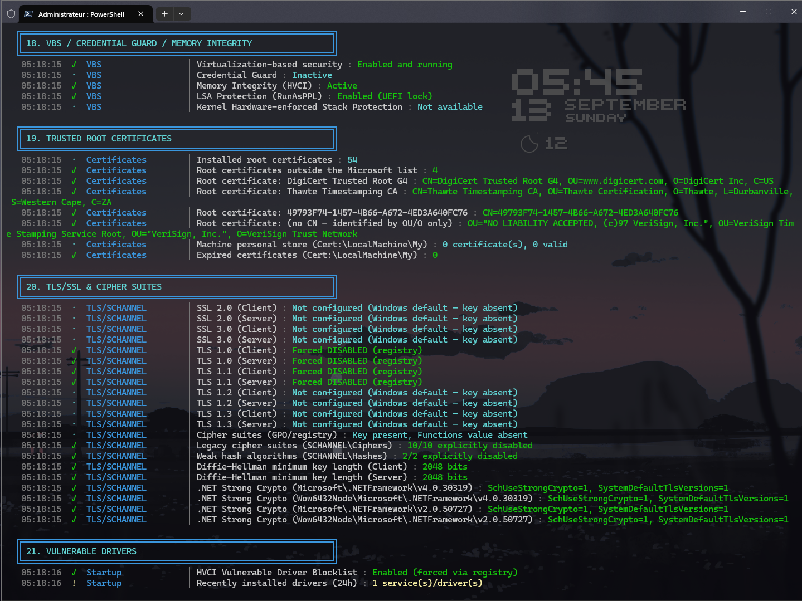
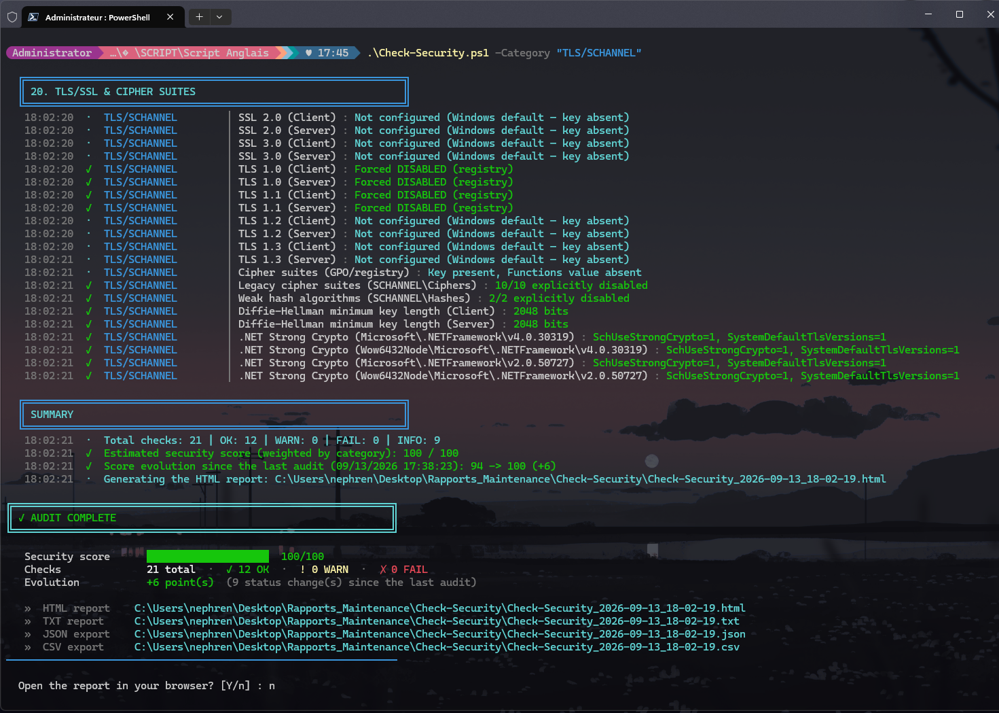

# Check-Security

🇬🇧 [English version](README.md)

Un audit de sécurité complet et non invasif pour Windows 11 — 22 sections couvrant tout, du statut Windows Update aux suites de chiffrement TLS, noté selon un modèle pondéré par catégorie, suivi dans le temps, et rendu sous forme de tableau de bord HTML avec recherche. Lecture seule : chaque vérification inspecte l'état du système, aucune ne le modifie.

> Rien n'est vérifié sur la base d'un nom. Les certificats racine de confiance sont validés par empreinte SHA-1/SHA-256 par rapport à une liste blanche vérifiée manuellement — jamais par leur nom (Subject CN), que n'importe quel certificat auto-signé malveillant pourrait copier. Le modèle de score lui-même a déjà été entièrement reconstruit une fois, après que la version originale ait produit un score de 1/100 sur une machine pourtant bien durcie.

**À partir de la v5.1.0, le script lui-même (console, rapports HTML/TXT/JSON/CSV, noms de catégories, valeurs de `-Category`) est entièrement en anglais** — ce README reste en français, mais les libellés réellement affichés par le script (ex. "Critical points", "BitLocker") sont ceux en anglais. Quelques contrôles dont l'*entrée* est Windows lui-même — `auditpol`, `wbadmin` — savent lire les formulations anglaises ET françaises que ces commandes peuvent renvoyer, donc le script continue de fonctionner correctement sur un Windows en français, pas seulement en anglais. Les shadow copies ne dépendent plus du tout de l'analyse de texte : depuis la **v5.4.2** elles sont lues via CIM (`Win32_ShadowCopy` / `Win32_ShadowStorage`), indépendant de la langue — `vssadmin` n'est conservé qu'en secours.

---

## Sommaire

- [Présentation](#présentation)
- [Captures d'écran](#captures-décran)
- [Comment fonctionne le score](#comment-fonctionne-le-score)
- [Les 22 sections](#les-22-sections)
- [Historique et détection de régression](#historique-et-détection-de-régression)
- [Utiliser le filtre `-Category`](#utiliser-le-filtre--category)
- [Prérequis](#prérequis)
- [Premier lancement](#premier-lancement-pas-à-pas)
- [Paramètres en ligne de commande](#paramètres-en-ligne-de-commande)
- [Rapports générés](#rapports-générés)
- [Déploiement multi-machines](#déploiement-multi-machines)
- [Dépannage](#dépannage)

---

## Présentation

`Check-Security.ps1` exécute un audit en une passe de la posture de sécurité d'une machine Windows 11 : statut Windows Update, pare-feu, Defender, politique de comptes/mots de passe, BitLocker, exposition des protocoles réseau, tâches planifiées, programmes au démarrage, VBS/Credential Guard/HVCI, configuration TLS/chiffrement, magasin de confiance des certificats, résilience anti-ransomware (Shadow Copy/VSS), et plus encore — 22 sections au total.

Il est entièrement **en lecture seule**. Aucune vérification ne modifie un paramètre, n'arrête un service, ni n'écrit dans le registre en dehors de ses propres fichiers de rapport/historique — il ne fait que lire et rapporter.

Chaque constat est enregistré avec une catégorie, un statut (`OK` / `WARN` / `FAIL` / `INFO`), et un détail en langage clair. L'ensemble se résume en un **score pondéré sur 100**, et chaque run est comparé au précédent pour faire ressortir ce qui a changé.

---

## Captures d'écran

<p align="center">
  
  
</p>

Davantage dans [`screenshots/`](screenshots/) — sortie console section par section, et le rapport HTML complet.

---

## Comment fonctionne le score

Le modèle de scoring a connu une refonte documentée (v4.1) après que l'approche originale "100 − somme des pénalités" ait produit un score de 1/100 sur une machine qui avait pourtant HVCI, LSA Protection, Secure Boot et 18 règles ASR actives — les pénalités s'accumulaient sans limite à mesure que de nouveaux contrôles étaient ajoutés, indépendamment de la posture globale.

Le modèle actuel est un **taux de réussite pondéré par catégorie** :

```
Pour chaque catégorie C :
    OK / INFO → 1.0   (réussi complètement)
    WARN      → 0.5   (demi-crédit)
    FAIL      → 0.0   (en échec)
    taux(C) = moyenne des valeurs ci-dessus sur tous les contrôles de cette catégorie

Score = Σ(poids(C) × taux(C)) / Σ(poids(C)) × 100
```

Ceci est invariant au nombre de contrôles présent dans chaque catégorie, et un seul `FAIL` dans une petite catégorie ne peut plus faire couler tout le score comme c'était le cas avec l'ancien modèle.

**Poids par catégorie** (les catégories non listées ont un poids par défaut de 1.0) :

| Catégorie (valeur réelle, en anglais) | Poids | Catégorie (valeur réelle, en anglais) | Poids |
|---|---|---|---|
| Antivirus | 1.6 | Certificates | 1.3 |
| BitLocker | 1.6 | Firewall | 1.4 |
| VBS | 1.5 | Network | 1.4 |
| Backup | 1.5 | TLS/SCHANNEL | 1.4 |
| Password Policy | 1.3 | Hardening | 1.4 |
| Accounts | 1.2 | Defender | 1.1 |
| Services | 0.8 | Startup | 0.7 |
| Software | 0.5 | | |

L'intention : un `FAIL` sur BitLocker ou l'antivirus doit peser plus lourd qu'un `FAIL` sur "logiciels installés" — les poids codent ce jugement explicitement plutôt que de laisser chaque contrôle avoir la même importance par accident.

---

## Les 22 sections

<details>
<summary><strong>1–5 · Système, Windows Update, Pare-feu, Defender, Comptes</strong></summary>

Infos système + signature Authenticode du script lui-même ; ancienneté du dernier patch (WARN >30 jours, FAIL >60) ; statut du pare-feu par profil et classification des règles par éditeur (signé Microsoft → INFO, tiers/non signé → WARN) ; protection en temps réel Defender, ancienneté du dernier scan (WARN >7 jours, FAIL >30), historique des détections de menaces sur 30 jours ; comptes locaux, politique de mot de passe, et le compte Administrator intégré (RID-500) spécifiquement.
</details>

### Politique de mot de passe, en détail

**Ce contrôle vérifie la politique locale que Windows imposerait lors d'un *futur* changement de mot de passe — pas ton mot de passe actuel.** `Minimum length required by local policy: 0 characters` (la valeur par défaut Windows à l'installation) ne veut pas dire que ton mot de passe actuel fait 0 caractère, ni qu'il a un problème — ça veut dire que si le mot de passe de ce compte était changé demain, Windows n'imposerait aucun minimum. Tu peux très bien avoir un mot de passe long et solide en place actuellement malgré une politique permissive ici ; le script le précise explicitement dans le détail de chaque résultat.

| Contrôle | Ce qu'il rapporte |
|---|---|
| **Longueur minimale** | `WARN` en dessous de 12 caractères — voir ci-dessous pourquoi |
| **Âge maximal / minimal du mot de passe** | Informatif — à quelle fréquence Windows forcerait un changement, et le délai minimal avant de pouvoir en rechanger |
| **Seuil de verrouillage** | `WARN` si désactivé (`0` tentative) — aucun verrouillage automatique après des échecs de connexion répétés |
| **Durée de verrouillage** | `WARN` si configurée à moins de 5 minutes — trop court pour freiner efficacement des salves rapides de force brute |

**Pourquoi 12 caractères précisément ?** C'est la recommandation actuelle la plus répandue (NIST SP 800-63B, CISA, ANSSI) — l'ancien standard "8 caractères" date d'une époque où le craquage hors-ligne était bien plus lent. Sur du matériel GPU moderne, un hash NTLM à 8 caractères — complexe ou non — peut tomber en force brute en quelques heures ; chaque caractère supplémentaire multiplie l'espace de recherche par environ 95 (la plage ASCII imprimable). 12 est à peu près le point où même une attaque hors-ligne soutenue cesse d'être rentable, d'où le glissement général (NIST inclus) de la "complexité obligatoire" vers la "longueur d'abord".

Pour relever le seuil : `net accounts /minpwlen:12` (ajuste le chiffre à ta convenance). C'est un réglage de politique, pas la correction de quelque chose d'activement cassé — traite un `WARN` ici comme une recommandation, pas comme une erreur.

<details>
<summary><strong>6–10 · UAC, BitLocker, Réseau, Services, Journaux d'audit</strong></summary>

Niveau UAC ; BitLocker (lecteur système `C:` → FAIL si désactivé, autres volumes → WARN) ; ports en écoute classés par exposition (RDP sur `0.0.0.0` → FAIL, WinRM → WARN fort, RPC 135/SMB 445 sur interfaces système → INFO car comportement Windows normal), connexions TCP établies vers des IP publiques enrichies avec le nom du processus, exposition pare-feu IPv6, profil réseau actif par interface ; services auto-démarrés non-système avec chemins suspects ; configuration de la politique d'audit et événements de sécurité récents (4648 connexions avec identifiants explicites, 4720/4726 création/suppression de compte).
</details>

<details>
<summary><strong>11–15 · Tâches planifiées, Secure Boot/TPM, PowerShell, Logiciels, Démarrage</strong></summary>

Tâches planifiées suspectes ; statut Secure Boot et TPM ; politique d'exécution PowerShell, Script Block Logging/Transcription (rétrogradés en INFO sur un poste personnel — ce sont des outils forensiques d'entreprise qui ajoutent du bruit sans SOC pour surveiller les journaux), Smart App Control (sensible à la compatibilité CPU : "non disponible" sur du matériel non compatible est INFO, pas un avertissement) ; inventaire des logiciels installés ; programmes au démarrage depuis à la fois les autoruns registre et les dossiers Démarrage, contrôles de persistance par détournement IFEO et `AppInit_DLLs`.
</details>

<details>
<summary><strong>16–19 · Exclusions Defender, Windows Hello, VBS, Certificats</strong></summary>

Exclusions de chemin/extension/processus Defender (signalées si trop larges) ; enrôlement PIN/biométrique Windows Hello ; VBS, Credential Guard, Memory Integrity (HVCI), et LSA Protection (RunAsPPL) ; certificats racine de confiance validés par **empreinte par rapport à une liste blanche vérifiée manuellement** (voir ci-dessous) et certificats expirés dans le magasin personnel.
</details>

<details>
<summary><strong>20–22 · Suites TLS/chiffrement, Pilotes vulnérables, Shadow Copy/VSS</strong></summary>

**TLS/SCHANNEL** — cinq contrôles indépendants, détaillés juste après le tableau : état des protocoles (TLS 1.0/1.1 désactivés, TLS 1.2/1.3 activés), une politique GPO forçant l'ordre des suites de chiffrement si elle existe, les chiffrements legacy individuels (RC4/DES/RC2/3DES/NULL) désactivés au niveau registre, les algorithmes de hachage faibles (MD5/SHA-1), la longueur minimale de clé Diffie-Hellman, et le Strong Crypto .NET Framework sur chaque installation .NET réellement présente. **Pilotes** vérifiés contre la liste de blocage HVCI de Microsoft et pilotes récemment installés. **Shadow Copy/VSS** — service Volume Shadow Copy, snapshots locaux de `C:`, espace réservé aux snapshots sur chaque volume, et sauvegardes d'image système (`wbadmin`) — tout est pertinent pour la récupération après ransomware, détaillé [plus bas](#shadow-copyvss-en-détail).
</details>

### TLS/SCHANNEL, en détail

SCHANNEL est le composant Windows bas niveau par lequel passe toute connexion TLS/SSL sur la machine — RDP, LDAPS, IIS, la plupart des applications .NET, et beaucoup de logiciels tiers qui n'embarquent pas leur propre pile TLS. La Section 20 lit son état sur cinq surfaces de registre indépendantes :

| Contrôle | Ce que ça signifie si c'est faible |
|---|---|
| **Protocoles** (TLS 1.0/1.1/1.2/1.3) | TLS 1.0/1.1 sont obsolètes et vulnérables à **POODLE**/**BEAST** — ils doivent être désactivés, côté client comme côté serveur |
| **Ordre des suites de chiffrement (GPO)** | Une Group Policy de domaine ou locale peut forcer une liste de suites précise ; si elle existe, elle ne doit pas contenir RC4, 3DES, DES, NULL ou EXPORT |
| **Chiffrements legacy individuels** | RC4, DES, RC2, Triple DES 168 et NULL peuvent chacun être désactivés indépendamment au niveau registre — le mécanisme réellement utilisé hors domaine, distinct du contrôle GPO ci-dessus |
| **Algorithmes de hachage faibles** | MD5 et SHA-1 sont encore acceptés par SCHANNEL sauf désactivation explicite |
| **Longueur minimale de clé Diffie-Hellman** | En dessous de 2048 bits, une connexion est vulnérable à une dégradation type **Logjam** |
| **Strong Crypto .NET Framework** | Sans ça, une application .NET peut contourner tous les réglages ci-dessus et négocier le TLS via sa propre pile obsolète |

<p align="center"></p>

POODLE, BEAST et Logjam ne sont pas des menaces théoriques — ce sont des attaques nommées et pratiques contre exactement les réglages par défaut que Windows continue d'expédier tant que personne ne les désactive explicitement. Une machine jamais touchée affichera la plupart de cette section en `WARN` ou en `INFO` ("valeur par défaut Windows") — c'est attendu, pas un bug de l'audit.

**Check-Security se contente de lire cet état — il n'écrit jamais dans le registre.** Si la Section 20 remonte des `WARN`, c'est un constat, pas une correction. Pour durcir réellement TLS/SCHANNEL sur la machine, lance le script complémentaire **[Harden-TLS](https://github.com/NephVx2/Harden-TLS)** (même auteur, même suite), puis relance Check-Security ensuite pour confirmer que le changement a bien pris effet.

**Validation de confiance des certificats, en détail :** la liste blanche des certificats racine "connus comme sains" est indexée par **empreinte SHA-1/SHA-256**, pas par Subject CN — un choix de conception délibéré expliqué directement dans le script : le nom affiché d'un certificat n'est qu'une chaîne de caractères, et n'importe quel certificat auto-signé pourrait définir son CN sur `"DigiCert Trusted Root G4"`. Une correspondance par nom serait trivialement contournable ; une correspondance par empreinte signifie qu'une entrée ne peut être légitime que si quelqu'un a réellement vérifié ce certificat précis.

### Shadow Copy/VSS, en détail

La section 22 répond à une seule question : *si un ransomware chiffrait cette machine cette nuit, que pourrais-tu récupérer ?* Les ransomwares suppriment couramment les shadow copies locales en premier, donc la réponse dépend de plusieurs éléments.

| Contrôle | Ce qu'il rapporte |
|---|---|
| **Service VSS** | Type de démarrage du service Volume Shadow Copy. `Manual` est normal — il démarre à la demande pour les opérations de snapshot et de sauvegarde |
| **Shadow copies on C:** | Nombre et ancienneté des snapshots VSS locaux du lecteur système, lus via CIM (`Win32_ShadowCopy`, filtré sur le volume système). `OK` si le dernier a 7 jours ou moins, `WARN` s'il est plus ancien, `FAIL` s'il n'y a ni snapshot ni point de restauration. Les snapshots stockés pour *d'autres* volumes ne sont pas comptés ici |
| **VSS shadow storage** | Espace réservé aux snapshots sur chaque volume (`Win32_ShadowStorage`). `WARN` quand une limite est utilisée à 80 % ou plus — Windows supprime alors lui-même les plus anciens snapshots, ce qui plafonne l'historique — ou quand un volume n'a **aucune limite** et que ses snapshots occupent déjà 20 % ou plus du disque qui les héberge ; `INFO` en dessous. La commande `vssadmin resize shadowstorage` pour ajuster est donnée dans le détail |
| **System image backup / scheduling** | Versions de sauvegarde `wbadmin`, ancienneté de la dernière, et tâche planifiée Windows Backup |

Trois choses à savoir :

- **Moins de snapshots que prévu est généralement une limite de stockage, pas un problème de détection** — voir [Dépannage](#dépannage).
- La fenêtre Restauration du système de Windows (`rstrui`, avec *Afficher d'autres points de restauration* coché) liste les vrais points de restauration **et** les sauvegardes d'image système `wbadmin` stockées sur d'autres disques, donc cette liste est normalement plus longue que le compte de "Shadow copies on C:". Les deux sont justes ; ils mesurent des choses différentes.
- Des sauvegardes d'image système conservées sur un disque toujours connecté peuvent être chiffrées par le même ransomware que celui qui touche `C:`. Check-Security ne peut pas savoir si ton disque de sauvegarde est déconnecté entre deux runs — une copie hors ligne reste la protection la plus solide.

---

## Historique et détection de régression

Chaque run écrit son score dans un fichier d'historique glissant (20 derniers runs) et se compare au run immédiatement précédent :

- **Deltas par contrôle** — tout ce qui a changé de statut (ex : `OK → WARN`) depuis la dernière fois est signalé spécifiquement, pas seulement le score global.
- **Alerte de régression** — si le score chute de plus de `$ScoreRegressionThreshold` (par défaut : **5 points**) depuis le dernier run, une bannière rouge apparaît en console et dans le rapport HTML. Une variation de 1 à 2 points est un bruit normal ; une chute de 5+ points signale un changement réel.
- **Sparkline de tendance** — un petit graphique SVG des 20 derniers scores, rendu directement dans le rapport HTML.
- **Résumé exécutif** — un bloc "Points critiques" tout en haut du rapport HTML liste chaque `FAIL` actuel (puis les `WARN`, jusqu'à 10 au total) avant même de défiler dans le détail complet des 22 sections.

---

## Utiliser le filtre `-Category`

`-Category` ne relance que les sections correspondantes, au lieu de l'audit complet d'environ 3 minutes — pratique juste après un correctif ciblé (BitLocker activé, Harden-TLS exécuté, un service désactivé) quand on veut juste confirmer qu'un point précis a changé.

```powershell
.\Check-Security.ps1 -Category "BitLocker"
.\Check-Security.ps1 -Category "BitLocker","TLS/SCHANNEL"
```

C'est un `[string[]]`, donc on peut passer une ou plusieurs valeurs, séparées par des virgules. Une section s'exécute si *au moins une* de ses propres catégories correspond partiellement à *au moins une* des valeurs passées (`-like` dans les deux sens), donc `-Category "TLS"` matche aussi la catégorie `TLS/SCHANNEL`. Les valeurs acceptées sont celles du tableau de poids par catégorie plus haut, plus quelques catégories de contrôles sans poids personnalisé (`System`, `Updates`, `UAC`, `Audit`, `Scheduled Tasks`, `UEFI Security`, `Windows Hello`, `Defender`) — voir l'aide intégrée du script (`Get-Help .\Check-Security.ps1 -Full`) pour la liste exacte sous `-Category`.

Deux états ($OS/$CS/$BIOS/$CPU, et la détection Windows Hello) sont partagés entre des sections qui ne tournent pas forcément ensemble, donc ils sont toujours calculés quel que soit le `-Category` passé — le filtre ne laisse jamais l'en-tête du rapport HTML ou le contrôle Windows Hello sans données.

<p align="center"></p>

---

## Prérequis

- Windows 11 (le script vérifie le numéro de build et rapporte `FAIL` s'il est exécuté sur un OS plus ancien — il continue de s'exécuter, mais se signale lui-même comme hors de son périmètre prévu).
- PowerShell 5.1 (intégré à Windows) ou PowerShell 7+.
- Droits administrateur (le script s'auto-élève via une invite UAC s'il est lancé depuis une session non élevée).
- Si le script est signé numériquement (recommandé en environnement `-ExecutionPolicy AllSigned`/`RemoteSigned`) : le certificat de signature doit être approuvé sur la machine cible.

---

## Premier lancement (pas à pas)

1. Copier `Check-Security.ps1` sur la machine cible.

2. Ouvrir PowerShell (l'élévation n'est pas nécessaire pour le lancer — le script s'auto-élève lui-même via une invite UAC).

   Puis se placer dans le dossier qui contient le script (adapter le chemin ; garder les guillemets s'il contient des espaces) :

   ```powershell
   cd "$HOME\Downloads"
   ```

3. **Débloquer le script** s'il a été téléchargé depuis Internet. Windows marque les fichiers téléchargés, et la politique d'exécution de PowerShell (`RemoteSigned`, par exemple) refuse de lancer un script marqué. Dans cette même fenêtre Administrateur, depuis le dossier du script :

   ```powershell
   Unblock-File .\Check-Security.ps1
   ```

   Si PowerShell indique plutôt que l'exécution de scripts est désactivée sur ce système (la politique par défaut de Windows est `Restricted`), autoriser d'abord les scripts pour le compte courant (la modification ne s'applique qu'à ce compte, pas à toute la machine) :

   ```powershell
   Set-ExecutionPolicy -Scope CurrentUser -ExecutionPolicy RemoteSigned
   ```

   Toujours bloqué ? Voir le [guide pas à pas](https://github.com/NephVx2/Script-blocked-Look-at-this/blob/main/README_POWERSHELL_FRENCH.md).

4. Lancer d'abord le self-test — aucun fichier écrit, aucune modification système :

   ```powershell
   .\Check-Security.ps1 -SelfTest
   ```
   
   Exécute 48 assertions internes (fonction d'échappement HTML, rendu des badges de statut, table des poids par catégorie, la fonction ShouldRunSection elle-même, cohérence du seuil de régression du score, et plus). Code de sortie 0 = tout passe, 1 = au moins un échec.

5. Lancer l'audit complet :

   ```powershell
   .\Check-Security.ps1
   ```

   Prend environ quelques minutes selon la machine (les requêtes de journaux d'événements et l'énumération des certificats sont généralement les étapes les plus lentes). Suivre en console le flux en direct `[OK]`/`[WARN]`/`[FAIL]`/`[INFO]` à mesure que chaque section se termine.

6. À la fin, la console affiche une bannière finale avec le score pondéré, suivie de jusqu'à 5 constats `FAIL` et 5 `WARN` pour une lecture immédiate sans ouvrir le rapport HTML.

7. Ouvrir le rapport HTML généré (le script propose de le faire automatiquement sauf si `-Silent` est utilisé) — commencer par le bloc "Points critiques" en haut, puis utiliser la barre de recherche pour sauter vers un contrôle spécifique.

8. Sur les **deuxième run et suivants**, la console et le rapport HTML afficheront en plus ce qui a changé depuis la dernière fois, et une bannière de régression si le score a chuté de plus de 5 points.

9. Si un `FAIL` spécifique nécessite une réponse vérifiée à la source (ex : "ce certificat racine est-il légitime ?"), ne pas se fier uniquement au rapport — vérifier l'empreinte du certificat par rapport à la liste publiée par Microsoft ou l'éditeur lui-même avant de l'ajouter à la liste blanche dans le script.

---

## Paramètres en ligne de commande

| Paramètre | Description |
|---|---|
| `-Silent` | Supprime la sortie console, le prompt "ouvrir dans le navigateur", et la pause ENTRÉE finale — pour un usage via tâche planifiée. Les rapports (HTML/TXT/JSON/CSV) sont toujours générés normalement. |
| `-SelfTest` | Exécute la batterie de tests internes à 48 assertions puis quitte. Passe par la même auto-élévation UAC qu'un lancement normal, aucun rapport généré, rien de modifié. Code de sortie `0`/`1`. |
| `-Category <nom(s)>` | Ne relance que les sections correspondantes — voir [Utiliser le filtre -Category](#utiliser-le-filtre--category) ci-dessus. |

**Exemples :**

```powershell
.\Check-Security.ps1 -SelfTest
.\Check-Security.ps1
.\Check-Security.ps1 -Silent
```

---

## Rapports générés

Chaque run réel (hors `-SelfTest`) écrit dans :

```
%USERPROFILE%\Desktop\Maintenance_Reports\Check-Security\
```

| Fichier | Contenu |
|---|---|
| `Check-Security_<horodatage>.html` | Tableau de bord complet : résumé exécutif ("Points critiques"), score pondéré, tableau de répartition par catégorie, sparkline de tendance, bannière de régression le cas échéant, détail complet des 22 sections avec recherche/filtre et ancres |
| `Check-Security_<horodatage>.txt` | Équivalent texte brut de l'ensemble des constats |
| `Check-Security_<horodatage>.json` | Export complet machine-readable de chaque constat |
| `Check-Security_<horodatage>.csv` | Export tabulaire de chaque constat |
| `_last_audit_baseline.json` | Instantané du dernier run uniquement, écrasé à chaque run — utilisé pour calculer les deltas par contrôle |
| `_score_history.json` | Historique glissant des 20 derniers couples (date, score) — utilisé pour la sparkline de tendance |

---

## Déploiement multi-machines

1. **Distribuer** le fichier `.ps1` vers chaque machine cible.

2. **Approuver le certificat de signature** si une politique d'exécution stricte est en place (`-ExecutionPolicy AllSigned`/`RemoteSigned`).

3. **Exécuter `-SelfTest` en premier** sur chaque machine pour confirmer que le script lui-même est intact avant de se fier à un audit complet.

4. **Planifier via le Planificateur de tâches Windows** avec `-Silent` et la case **Exécuter avec les autorisations maximales** cochée. Une tâche planifiée s'exécute sans session interactive, donc l'invite UAC d'auto-élévation du script n'a nulle part où s'afficher — la tâche elle-même doit déjà être configurée pour s'exécuter élevée :

   | Champ | Valeur |
   |---|---|
   | Programme/script | `pwsh.exe` (ou `powershell.exe`) |
   | Arguments | `-NoProfile -ExecutionPolicy Bypass -File "C:\Scripts\Security\Check-Security.ps1" -Silent` |
   | Exécuter avec les autorisations maximales | Oui |

5. **Consulter d'abord le résumé "Critical points"** (le rapport est entièrement en anglais depuis la v5.1.0) sur le rapport HTML de chaque machine plutôt que de lire les 22 sections complètes à chaque fois — c'est exactement à ça qu'il sert.

6. Les rapports, la baseline et l'historique sont **propres à chaque machine** — aucune donnée n'est centralisée automatiquement. Pour une vue consolidée sur un parc, une étape de collecte séparée (partage réseau, remontée de logs) devrait être ajoutée par-dessus ce script.

7. **La liste blanche de certificats est spécifique à la machine par conception.** Le `$TrustedRootThumbprintAllowlist` du script a été rempli en vérifiant manuellement des certificats spécifiques trouvés sur une machine particulière (NEPH-DESKTOP). Déployer ce script tel quel sur une autre machine signifie que ses propres certificats racine légitimes mais différents apparaîtront comme non reconnus — c'est le script qui fonctionne correctement, pas un bug. Revoir et étendre la liste blanche par machine (ou par image de parc connue) plutôt que de supposer qu'une seule liste blanche convient à toutes les cibles de déploiement.

---

## Dépannage

<details>
<summary><strong>Le script ne démarre pas du tout</strong></summary>

Depuis la v5.4.1 le script s'auto-élève : une invite UAC doit apparaître automatiquement s'il est lancé depuis une session non élevée. Si rien ne se passe, l'invite a probablement été refusée — relancer et l'accepter. Dans un contexte non interactif (tâche planifiée, session distante sans bureau), l'invite UAC n'a nulle part où s'afficher ; vérifier que la tâche/session elle-même est déjà configurée pour s'exécuter élevée (voir l'entrée Planificateur de tâches ci-dessus).
</details>

<details>
<summary><strong>Un certificat racine tout nouveau apparaît comme non reconnu</strong></summary>

Attendu sur toute machine autre que celle pour laquelle la liste blanche a été construite (voir [Déploiement multi-machines](#déploiement-multi-machines)). Vérifier l'empreinte du certificat de manière indépendante (liste racine publiée par Microsoft, documentation de l'éditeur, ou `certutil`) avant de l'ajouter à `$TrustedRootThumbprintAllowlist` — ne jamais ajouter une empreinte simplement parce que le rapport l'a signalée, cela va à l'encontre du but de la liste blanche.
</details>

<details>
<summary><strong>Le score a chuté et je ne sais pas pourquoi</strong></summary>

Consulter la bannière de régression du rapport HTML (affichée uniquement si la chute dépasse `$ScoreRegressionThreshold`, 5 points par défaut) et la liste des deltas par contrôle — les deux sont calculés automatiquement par comparaison avec `_last_audit_baseline.json`. Une variation de 1 à 2 points entre deux runs peut être un bruit normal dans une catégorie ne comptant que quelques contrôles.
</details>

<details>
<summary><strong>"Shadow copies on C:" affiche moins de snapshots que prévu</strong></summary>

Généralement une limite de stockage, pas un problème de détection : quand l'espace réservé aux snapshots sur `C:` est plein, Windows supprime silencieusement le plus ancien pour faire de la place à chaque nouveau, donc le compte reste bloqué autour du même nombre. Vérifier avec `vssadmin list shadowstorage` — la ligne "VSS shadow storage" du rapport le signale aussi à partir de 80 % de la limite. Pour conserver plus d'historique, relever la limite : `vssadmin resize shadowstorage /for=C: /on=C: /maxsize=<taille>`.

Seuls les snapshots de `C:` sont comptés sur cette ligne. Les snapshots des volumes de sauvegarde (`E:`, `F:`…) apparaissent dans les lignes "VSS shadow storage" et `wbadmin`, et la fenêtre Restauration du système de Windows mélange les deux types dans une liste plus longue (voir [Shadow Copy/VSS, en détail](#shadow-copyvss-en-détail)).
</details>

<details>
<summary><strong>-SelfTest signale un FAIL</strong></summary>

Lire directement le nom de l'assertion — il pointe vers une fonction utilitaire spécifique en échec (échappement HTML, rendu des badges de statut, un poids de catégorie manquant, etc.), pas vers la posture de sécurité réelle de la machine. C'est une auto-vérification du script, sans rapport avec ce qu'un audit complet rapporterait.
</details>

---

<sub>Check-Security — 22 sections, lecture seule, scoring pondéré par catégorie, confiance des certificats basée sur l'empreinte, self-test à 48 assertions.</sub>
