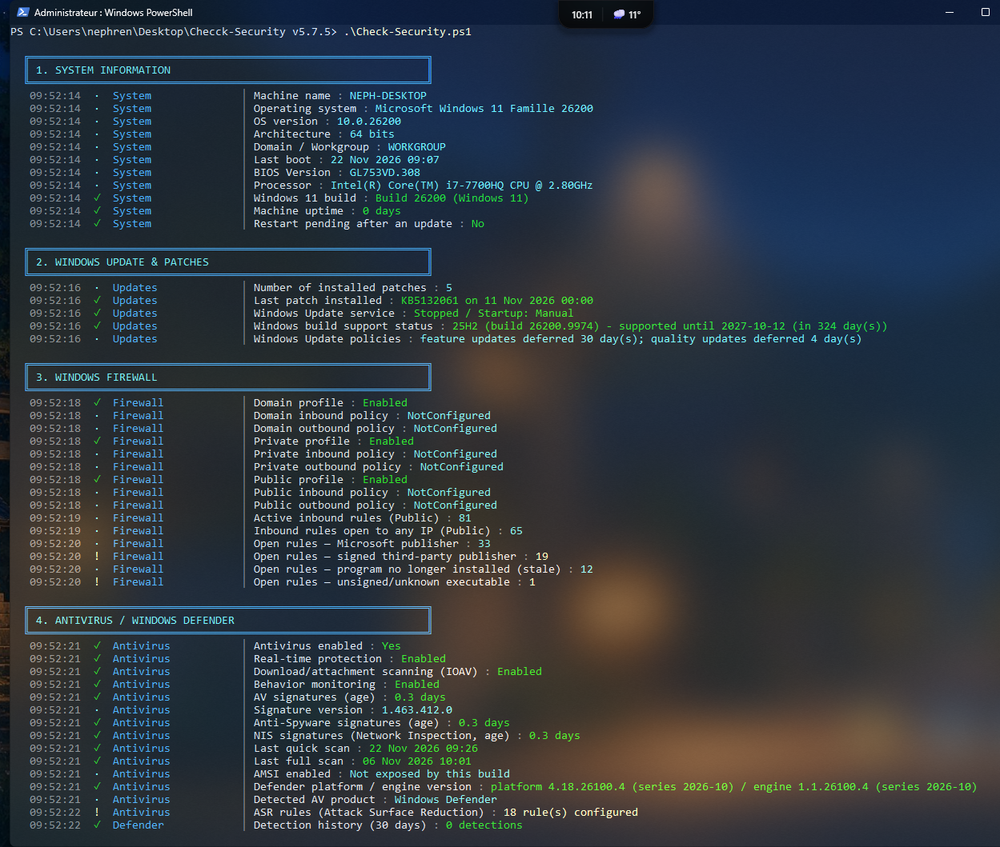
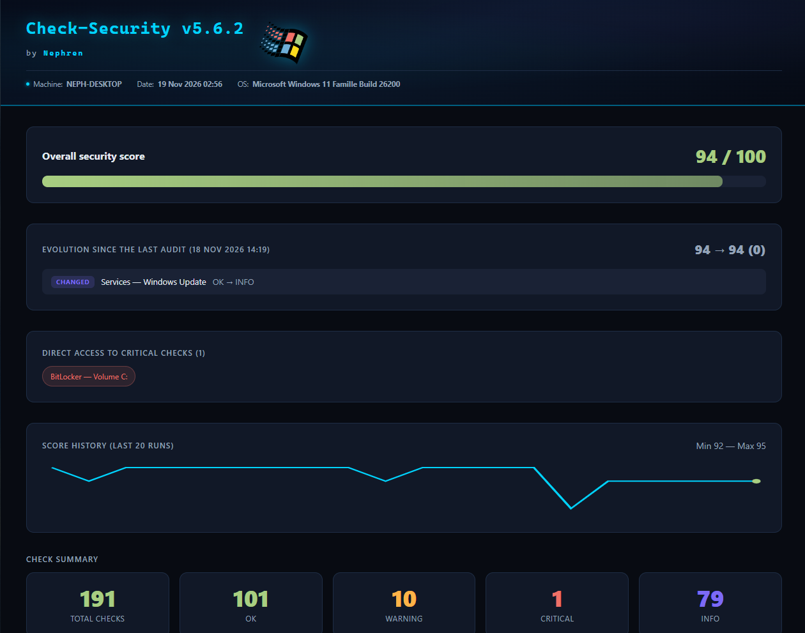
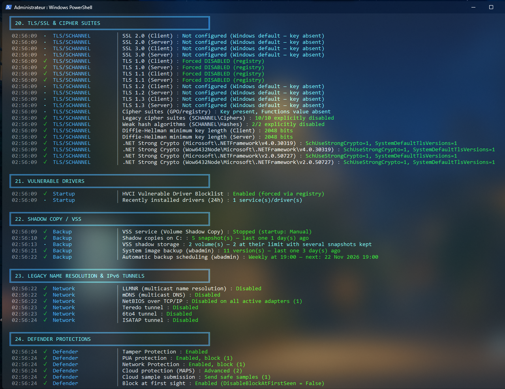
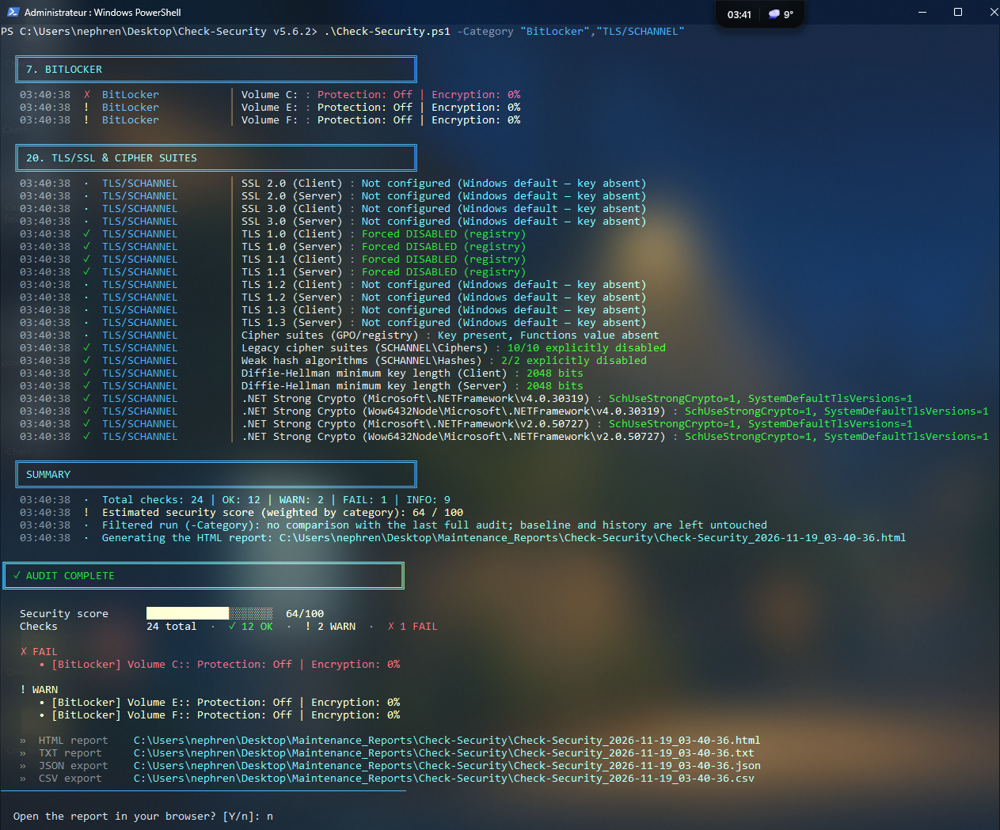

# Check-Security

🇬🇧 [English version](README.md)

Un audit de sécurité complet et non invasif pour Windows 11 — 27 sections couvrant tout, du statut Windows Update aux suites de chiffrement TLS et à l'exposition de l'accès distant, noté selon un modèle pondéré par catégorie, suivi dans le temps, et rendu sous forme de tableau de bord HTML avec recherche. Lecture seule : chaque vérification inspecte l'état du système, aucune ne le modifie.

> Rien n'est jugé sur la base d'un nom. Les certificats racine de confiance sont validés par empreinte SHA-1/SHA-256 par rapport à une liste blanche vérifiée manuellement — jamais par leur nom (Subject CN), que n'importe quel certificat auto-signé malveillant pourrait copier. Depuis la **v5.6.0**, la même règle s'applique au reste de l'audit : services, tâches planifiées, pilotes, règles de pare-feu et processus réseau sont jugés sur leur chemin de fichier ancré, leur signature Authenticode et les permissions de leur dossier — jamais sur un nom ni sur un mot trouvé dans un chemin (un dossier appelé `Microsoft` ou `system32` ne prouve rien : n'importe qui peut le créer). Le modèle de score lui-même a déjà été entièrement reconstruit une fois, après que la version originale ait produit un score de 1/100 sur une machine pourtant bien durcie.

**À partir de la v5.1.0, le script lui-même (console, rapports HTML/TXT/JSON/CSV, noms de catégories, valeurs de `-Category`) est entièrement en anglais** — ce README reste en français, mais les libellés réellement affichés par le script (ex. "Critical points", "BitLocker") sont ceux en anglais. Quelques contrôles dont l'*entrée* est Windows lui-même — `auditpol`, `wbadmin` — savent lire les formulations anglaises ET françaises que ces commandes peuvent renvoyer, donc le script continue de fonctionner correctement sur un Windows en français, pas seulement en anglais. Les shadow copies ne dépendent plus du tout de l'analyse de texte : depuis la **v5.4.2** elles sont lues via CIM (`Win32_ShadowCopy` / `Win32_ShadowStorage`), indépendant de la langue — `vssadmin` n'est conservé qu'en secours. Depuis la **v5.6.0**, `net accounts` (dont les libellés sont traduits) n'est plus la seule source de la politique de mot de passe : quand sa sortie n'est pas reconnue, les mêmes valeurs sont lues dans la stratégie de sécurité locale exportée (`secedit`, clés indépendantes de la langue), et les règles de pare-feu sans programme sont reconnues par leur groupe de ressources plutôt que par un nom affiché en anglais.

---

## Sommaire

- [Présentation](#présentation)
- [Captures d'écran](#captures-décran)
- [Comment fonctionne le score](#comment-fonctionne-le-score)
- [Les 27 sections](#les-27-sections)
- [Nouveautés de la v5.6](#nouveautés-de-la-v56)
- [Historique et détection de régression](#historique-et-détection-de-régression)
- [Utiliser le filtre `-Category`](#utiliser-le-filtre--category)
- [Prérequis](#prérequis)
- [Premier lancement](#premier-lancement-pas-à-pas)
- [Paramètres en ligne de commande](#paramètres-en-ligne-de-commande)
- [Rapports générés](#rapports-générés)
- [Déploiement multi-machines](#déploiement-multi-machines)
- [Dépannage](#dépannage)

---

## Présentation

`Check-Security.ps1` exécute un audit en une passe de la posture de sécurité d'une machine Windows 11 : statut Windows Update, pare-feu, Defender, politique de comptes/mots de passe, BitLocker, exposition des protocoles réseau, tâches planifiées, programmes au démarrage, VBS/Credential Guard/HVCI, configuration TLS/chiffrement, magasin de confiance des certificats, résilience anti-ransomware (Shadow Copy/VSS), résolution de noms héritée et tunnels IPv6, protections Defender, PowerShell 2.0, services d'accès distant, identifiants stockés, et plus encore — 27 sections au total.

Il est entièrement **en lecture seule**. Aucune vérification ne modifie un paramètre, n'arrête un service, ni n'écrit dans le registre en dehors de ses propres fichiers de rapport/historique — il ne fait que lire et rapporter.

Depuis la v5.5.0, les constats des contrôles les plus récents se terminent par un indice qui nomme la commande correspondante du lanceur séparé **Toolbox-SystemCommands** (par exemple *Fix with Toolbox-SystemCommands > Quick security > 'Disable PowerShell 2.0'*). Check-Security lui-même ne corrige toujours rien : il détecte, la Toolbox corrige. Les indices se désactivent avec `$ShowToolboxHints`.

**La v5.6 est une version d'audit.** Elle fait suite à une revue technique du script ligne par ligne, puis à des vérifications sur une vraie machine Windows 11 : des résultats faux ou perdus en silence ont été corrigés, la confiance est passée des noms à des faits vérifiables, quelques contrôles ont été ajoutés, et un résultat qu'on n'a pas pu obtenir ne compte plus comme une réussite. Aucun poids et aucun nom de catégorie n'a changé, et chaque contrôle existant garde son nom. Voir [Nouveautés de la v5.6](#nouveautés-de-la-v56).

Chaque constat est enregistré avec une catégorie, un statut (`OK` / `WARN` / `FAIL` / `INFO`), et un détail en langage clair. L'ensemble se résume en un **score pondéré sur 100**, et chaque run est comparé au précédent pour faire ressortir ce qui a changé.

---

## Captures d'écran

<p align="center">
  
  
</p>

Davantage dans [`screenshots/`](screenshots/) — sortie console section par section, et le rapport HTML complet.

---

## Comment fonctionne le score

Le modèle de scoring a connu une refonte documentée (v4.1) après que l'approche originale "100 − somme des pénalités" ait produit un score de 1/100 sur une machine qui avait pourtant HVCI, LSA Protection, Secure Boot et 18 règles ASR actives — les pénalités s'accumulaient sans limite à mesure que de nouveaux contrôles étaient ajoutés, indépendamment de la posture globale.

Le modèle actuel est un **taux de réussite pondéré par catégorie** :

```
Pour chaque catégorie C :
    OK / INFO → 1.0   (réussi complètement)
    WARN      → 0.5   (demi-crédit)
    FAIL      → 0.0   (en échec)
    taux(C) = moyenne des valeurs ci-dessus sur tous les contrôles de cette catégorie
              (un contrôle qu'on n'a pas pu effectuer est écarté, voir plus bas)

Score = Σ(poids(C) × taux(C)) / Σ(poids(C)) × 100
```

Les pénalités ne peuvent plus s'empiler sans limite à mesure que des contrôles s'ajoutent, et les poids traduisent l'importance de chaque catégorie. Une conséquence à connaître : un contrôle pèse *le poids de sa catégorie divisé par le nombre de contrôles de cette catégorie*, donc un `FAIL` dans une catégorie de quelques contrôles fait plus bouger le score qu'un `FAIL` dans une grande catégorie (un volume BitLocker en échec coûte environ deux points sur une machine à trois volumes ; un contrôle en échec parmi une vingtaine de contrôles réseau coûte une fraction de point). C'est pourquoi le résumé et l'alerte « nouveau `FAIL` » (voir [Historique](#historique-et-détection-de-régression)) listent chaque contrôle en échec individuellement au lieu de s'en remettre au seul score.

**Contrôles qu'on n'a pas pu effectuer.** Depuis la v5.6.0, un résultat comme `Unable to read` ou `Not available` (fonction absente, erreur de lecture) est marqué `Indeterminate` dans l'export JSON et est **écarté du score**. Avant, il comptait comme `INFO`, donc comme une réussite complète : un réglage illisible pouvait faire monter le score. La ligne reste affichée dans tous les rapports.

**Poids par catégorie** (les catégories non listées ont un poids par défaut de 1.0) :

| Catégorie (valeur réelle, en anglais) | Poids | Catégorie (valeur réelle, en anglais) | Poids |
|---|---|---|---|
| Antivirus | 1.6 | Certificates | 1.3 |
| BitLocker | 1.6 | Firewall | 1.4 |
| VBS | 1.5 | Network | 1.4 |
| Backup | 1.5 | TLS/SCHANNEL | 1.4 |
| Password Policy | 1.3 | Hardening | 1.4 |
| Accounts | 1.2 | Defender | 1.1 |
| Services | 0.8 | Startup | 0.7 |
| Software | 0.5 | | |

L'intention : un `FAIL` sur BitLocker ou l'antivirus doit peser plus lourd qu'un `FAIL` sur "logiciels installés" — les poids codent ce jugement explicitement plutôt que de laisser chaque contrôle avoir la même importance par accident. (`Hardening` a un poids, mais aucun contrôle ne rapporte encore sous cette catégorie.)

---

## Les 27 sections

<details>
<summary><strong>1–5 · Système, Windows Update, Pare-feu, Defender, Comptes</strong></summary>

Infos système + signature Authenticode du script lui-même ; durée de fonctionnement (qui tient compte du démarrage rapide, lequel conserve la session noyau à l'arrêt) et **redémarrage en attente** après une mise à jour ; ancienneté du dernier patch, calculée uniquement sur les correctifs qui portent une date d'installation (WARN >30 jours, FAIL >60) ; statut du pare-feu par profil — une action entrante par défaut sur `Allow` est un `FAIL` — et règles entrantes lues dans le magasin **effectif** (stratégies de groupe et Intune comprises), y compris les règles dont le profil est `Any`, classées par signature de l'éditeur, groupe de ressources intégré ou emplacement (jamais par nom affiché) : signé Microsoft → INFO, tiers/non signé → WARN, les règles dont le programme n'existe plus étant listées à part en INFO (« stale ») ; protection en temps réel Defender (INFO au lieu de FAIL quand Defender est en mode passif parce qu'un autre antivirus est actif, dont l'état dans le Centre de sécurité est décodé), ancienneté du dernier scan (WARN >7 jours, FAIL >30), règles ASR dont les trois règles de protection standard de Microsoft, historique des détections de menaces sur 30 jours ; comptes locaux, politique de mot de passe, et le compte Administrator intégré (RID-500) spécifiquement.
</details>

### Politique de mot de passe, en détail

**Ce contrôle vérifie la politique locale que Windows imposerait lors d'un *futur* changement de mot de passe — pas ton mot de passe actuel.** `Minimum length required by local policy: 0 characters` (la valeur par défaut Windows à l'installation) ne veut pas dire que ton mot de passe actuel fait 0 caractère, ni qu'il a un problème — ça veut dire que si le mot de passe de ce compte était changé demain, Windows n'imposerait aucun minimum. Tu peux très bien avoir un mot de passe long et solide en place actuellement malgré une politique permissive ici ; le script le précise explicitement dans le détail de chaque résultat.

| Contrôle | Ce qu'il rapporte |
|---|---|
| **Longueur minimale** | `WARN` en dessous de 12 caractères — voir ci-dessous pourquoi |
| **Âge maximal / minimal du mot de passe** | Informatif — à quelle fréquence Windows forcerait un changement, et le délai minimal avant de pouvoir en rechanger |
| **Seuil de verrouillage** | `WARN` si désactivé (`0` tentative) — aucun verrouillage automatique après des échecs de connexion répétés |
| **Durée de verrouillage** | `WARN` si configurée à moins de 5 minutes — trop court pour freiner efficacement des salves rapides de force brute. Une durée de `0` / « jamais » signifie que le compte reste verrouillé jusqu'à ce qu'un administrateur le déverrouille : le réglage le plus strict, rapporté `OK` (il était lu auparavant comme « très courte ») |

**Pourquoi 12 caractères précisément ?** C'est la recommandation actuelle la plus répandue (NIST SP 800-63B, CISA, ANSSI) — l'ancien standard "8 caractères" date d'une époque où le craquage hors-ligne était bien plus lent. Sur du matériel GPU moderne, un hash NTLM à 8 caractères — complexe ou non — peut tomber en force brute en quelques heures ; chaque caractère supplémentaire multiplie l'espace de recherche par environ 95 (la plage ASCII imprimable). 12 est à peu près le point où même une attaque hors-ligne soutenue cesse d'être rentable, d'où le glissement général (NIST inclus) de la "complexité obligatoire" vers la "longueur d'abord".

Pour relever le seuil : `net accounts /minpwlen:12` (ajuste le chiffre à ta convenance). C'est un réglage de politique, pas la correction de quelque chose d'activement cassé — traite un `WARN` ici comme une recommandation, pas comme une erreur. Les valeurs sont lues depuis `net accounts` (libellés français et anglais) et, sur toute autre langue de Windows, depuis la stratégie de sécurité locale exportée (`secedit`) : le contrôle ne dépend donc pas de la langue.

**Comptes locaux et drapeaux de mot de passe.** Chaque ligne de compte local se termine par `Pwd expires: …`. `Never` signifie que le compte a un mot de passe qui n'expire jamais (`WARN`, une recommandation de durcissement : les recommandations actuelles comme NIST SP 800-63B ne demandent plus de rotation forcée, c'est donc un choix que tu peux assumer en connaissance de cause) ; `Yes` qu'il expire ; `n/a (no password set)` désigne un compte intégré qui n'a jamais eu de mot de passe (Administrateur, Invité, DefaultAccount) ; `Managed online` un compte lié à un compte Microsoft ou Entra ID, dont le mot de passe est géré en ligne. Par ailleurs, un compte local activé dont le drapeau SAM indique *mot de passe non requis* reçoit un `WARN` : le drapeau ne prouve pas que le mot de passe est vide, il signifie que Windows en *autoriserait* un vide, et le script ne peut pas le tester sans provoquer une connexion échouée (qui compterait dans ton seuil de verrouillage). Si le compte a bien un mot de passe, retire le drapeau avec `net user <nom> /passwordreq:yes` (définis d'abord un mot de passe s'il n'en a pas, sinon tu ne pourrais plus te connecter).

<details>
<summary><strong>6–10 · UAC, BitLocker, Réseau, Services, Journaux d'audit</strong></summary>

**UAC** par une table de décision : les niveaux de consentement 1 et 2 (invite sur le bureau sécurisé) sont plus stricts que la valeur par défaut et sont `OK`, le niveau 0 est `FAIL`, une valeur non définie correspond à la valeur par défaut de Windows (`INFO`) ; le filtrage distant du jeton (`LocalAccountTokenFilterPolicy`) est vérifié. **BitLocker** : lecteur système `C:` → FAIL si désactivé, autres volumes → WARN ; l'état du volume, de verrouillage, la méthode de chiffrement et les protecteurs de clé sont lus, donc un volume entièrement chiffré dont la protection est **suspendue** est un `WARN` (et non « non chiffré »), un volume verrouillé compte comme chiffré, et l'absence de protecteur par mot de passe de récupération est un `WARN`. **Réseau** : ports en écoute classés par exposition (RDP sur `0.0.0.0` → FAIL, WinRM → WARN fort) ; un port n'est « normal » que si un **processus Windows ou Microsoft vérifié** le possède, le seul numéro ne prouve rien, et un processus non vérifié qui écoute sur toutes les interfaces est un `WARN` ; connexions TCP établies vers des IP publiques enrichies avec le nom du processus, un nom n'étant retenu que si l'image du processus est vérifiée (dossier Windows, signature valide, ou emplacement de Program Files qu'un non-administrateur ne peut pas modifier) — PowerShell n'est pas dans la liste autorisée ; DNS chiffré (DoH) compare les serveurs DNS utilisés à la table DoH de Windows et aux réglages par interface ; partages : seuls les partages administratifs par défaut sont ignorés, donc un partage caché comme `backup$` est signalé ; exposition pare-feu IPv6 ; profil réseau actif par interface. **Services** : chaque service automatique en cours d'exécution est évalué — composants Windows par chemin ancré, services signés Microsoft dont l'emplacement est protégé, et tous les autres sont examinés (emplacement modifiable par un non-administrateur, pas de signature valide hors de Program Files, chemin sans guillemets contenant des espaces, compte utilisateur). **Audit** : configuration de la politique, événements de sécurité récents (4648 connexions avec identifiants explicites, 4720/4726 création/suppression de compte) — un journal illisible donne `Unable to read`, plus « 0 événement » — et journaux effacés (Sécurité 1102, Système 104) sur 90 jours.
</details>

<details>
<summary><strong>11–15 · Tâches planifiées, Secure Boot/TPM, PowerShell, Logiciels, Démarrage</strong></summary>

**Tâches planifiées.** Le dossier d'une tâche est choisi par celui qui la crée : une tâche placée sous `\Microsoft\` n'est donc plus exemptée, seul son binaire compte (un fichier Windows, ou une signature Microsoft valide). Les interpréteurs sont reconnus par **nom de fichier** (PowerShell 5/7, cmd, wscript, mshta, rundll32, msiexec, certutil, bitsadmin, curl, python, node, wsl…), les tâches en cours d'exécution sont incluses, et une commande encodée, un téléchargement en mémoire ou une fenêtre cachée dans les arguments est signalé. Une tâche est reconnue comme la tienne quand son script est dans un dossier de confiance (chemin normalisé), porte une signature Authenticode valide d'un éditeur présent dans le magasin Éditeurs approuvés, ou a été créée par Winhance avec un script que seuls les administrateurs peuvent modifier — et le script doit être ce que la tâche **exécute** réellement, pas un chemin qui apparaît simplement dans ses arguments. Depuis la v5.6.0, une tâche **élevée** (niveau d'exécution le plus élevé, SYSTEM ou compte de service) qui exécute un script modifiable par un non-administrateur n'est plus reconnue sur son seul chemin : celui qui peut modifier le script obtiendrait des droits d'administrateur (une signature valide d'un éditeur approuvé, ou une ACL protectrice, compte toujours). Statut Secure Boot et TPM ; politique d'exécution PowerShell (`Unrestricted`/`Bypass` est un `WARN` : Microsoft indique que la politique n'est pas une frontière de sécurité), Script Block Logging/Transcription (rétrogradés en INFO sur un poste personnel — ce sont des outils forensiques d'entreprise qui ajoutent du bruit sans SOC pour surveiller les journaux), Smart App Control (état lu dans la stratégie Code Integrity ; « non exposé par cette version » est INFO) ; inventaire des logiciels installés ; programmes au démarrage depuis à la fois les autoruns registre et les dossiers Démarrage, détournement IFEO, `AppInit_DLLs` et, depuis la v5.6.0, les valeurs `Shell`/`Userinit` de Winlogon et les consommateurs d'événements WMI qui lancent une commande ou un script (une persistance qui n'utilise aucun fichier dans un emplacement de démarrage).
</details>

<details>
<summary><strong>16–19 · Exclusions Defender, Windows Hello, VBS, Certificats</strong></summary>

Exclusions de chemin/extension/processus Defender : un chemin est signalé quand il est large (une racine de lecteur, `Windows`, `Users` ou un profil utilisateur entier, `ProgramData`, `Program Files` lui-même, Téléchargements, Temp, AppData, un joker final), et — depuis la v5.6.0 — exclure une **extension** exécutable ou de script (`.exe`, `.ps1`…) ou un **processus interpréteur** (`powershell.exe`, `cmd.exe`…) est un `WARN`, une manière classique d'aveugler un antivirus ; enrôlement PIN/biométrique Windows Hello ; VBS, Credential Guard, Memory Integrity (HVCI) — sur un matériel qui ne peut pas les exécuter, le résultat est INFO « non pris en charge », pas un avertissement — et LSA Protection (RunAsPPL), confirmée par l'événement Wininit quand aucune valeur de registre n'est définie ; certificats racine de confiance hors liste Microsoft, validés par **empreinte par rapport à une liste blanche vérifiée manuellement** (voir ci-dessous) — une vraie autorité non vérifiée est un `WARN`, un certificat end-entity non vérifié n'est qu'un `INFO` — les racines que Windows livre lui-même sont reconnues par leur empreinte (plus par le mot « Microsoft » dans leur sujet), les certificats racine installés **pour l'utilisateur courant seulement** (`Cert:\CurrentUser\Root`, qui ne demande aucun droit d'administrateur) sont aussi audités, et certificats expirés dans le magasin personnel.
</details>

<details>
<summary><strong>20–22 · Suites TLS/chiffrement, Pilotes vulnérables, Shadow Copy/VSS</strong></summary>

**TLS/SCHANNEL** — cinq contrôles indépendants, détaillés juste après le tableau : état des protocoles (TLS 1.0/1.1 désactivés, TLS 1.2/1.3 activés), une politique GPO forçant l'ordre des suites de chiffrement si elle existe, les chiffrements legacy individuels (RC4/DES/RC2/3DES/NULL) désactivés au niveau registre, les algorithmes de hachage faibles (MD5/SHA-1), la longueur minimale de clé Diffie-Hellman, et le Strong Crypto .NET Framework sur chaque installation .NET réellement présente. **Pilotes** vérifiés contre la liste de blocage HVCI de Microsoft et pilotes récemment installés (un service en mode utilisateur avec une signature valide, typiquement un programme de mise à jour d'application, est `INFO` ; les pilotes noyau et les exécutables non signés restent en `WARN`, avec la raison indiquée ; le test d'emplacement standard est une comparaison de chemin ancrée, donc un dossier simplement nommé `system32\drivers` dans un dossier utilisateur ne passe plus). **Shadow Copy/VSS** — service Volume Shadow Copy, snapshots locaux de `C:`, espace réservé aux snapshots sur chaque volume, et sauvegardes d'image système (`wbadmin`) — tout est pertinent pour la récupération après ransomware, détaillé [plus bas](#shadow-copyvss-en-détail).
</details>

<details>
<summary><strong>23–27 · Résolution de noms et tunnels IPv6, Protections Defender, PowerShell 2.0, Services d'accès distant, Identifiants stockés</strong></summary>

Ajoutées en v5.5.0. **Résolution de noms héritée et tunnels IPv6** — LLMNR (stratégie `EnableMulticast`), mDNS (`EnableMDNS`) et NetBIOS sur TCP/IP sur chaque carte active, plus les tunnels de transition Teredo, 6to4 et ISATAP, lus via les cmdlets NetworkTransition (pour Teredo, le type effectif rapporté par `netsh` compte aussi, car le désactiver avec `netsh` laisse le type configuré sur `Default`). **Protections Defender** — Tamper Protection, protection PUA, Network Protection et protection cloud en profondeur (envoi d'échantillons, block at first sight, niveau de blocage, délai étendu ; v5.5.1) et Controlled Folder Access, la protection anti-ransomware de Windows (v5.6.0). **PowerShell 2.0** — l'ancien moteur qui contourne AMSI et la journalisation des scripts (supprimé de Windows 11 à partir de la 24H2). **Services d'accès distant** — Remote Registry, WebClient, sshd / SSDP / UPnP / Routage et accès distant, les fonctionnalités client Telnet et TFTP, l'Assistance à distance. **Identifiants stockés** — ouverture automatique de session Winlogon et `DefaultPassword` en clair, plus (v5.6.0) WDigest, le stockage du hash LM, les réglages d'accès anonyme et le compte Invité. Chacune de ces sections réutilise une catégorie existante (`Network`, `Defender`, `PowerShell`, `Services`, `Accounts`), donc aucun poids n'a changé. Détaillées [ci-dessous](#sections-23-à-27-en-détail).
</details>

### TLS/SCHANNEL, en détail

SCHANNEL est le composant Windows bas niveau par lequel passe toute connexion TLS/SSL sur la machine — RDP, LDAPS, IIS, la plupart des applications .NET, et beaucoup de logiciels tiers qui n'embarquent pas leur propre pile TLS. La Section 20 lit son état sur cinq surfaces de registre indépendantes :

| Contrôle | Ce que ça signifie si c'est faible |
|---|---|
| **Protocoles** (TLS 1.0/1.1/1.2/1.3) | TLS 1.0/1.1 sont obsolètes et vulnérables à **POODLE**/**BEAST** — ils doivent être désactivés, côté client comme côté serveur |
| **Ordre des suites de chiffrement (GPO)** | Une Group Policy de domaine ou locale peut forcer une liste de suites précise ; si elle existe, elle ne doit pas contenir RC4, 3DES, DES, NULL ou EXPORT |
| **Chiffrements legacy individuels** | RC4, DES, RC2, Triple DES 168 et NULL peuvent chacun être désactivés indépendamment au niveau registre — le mécanisme réellement utilisé hors domaine, distinct du contrôle GPO ci-dessus |
| **Algorithmes de hachage faibles** | MD5 et SHA-1 sont encore acceptés par SCHANNEL sauf désactivation explicite |
| **Longueur minimale de clé Diffie-Hellman** | En dessous de 2048 bits, une connexion est vulnérable à une dégradation type **Logjam** |
| **Strong Crypto .NET Framework** | Sans ça, une application .NET peut contourner tous les réglages ci-dessus et négocier le TLS via sa propre pile obsolète |

<p align="center"></p>

POODLE, BEAST et Logjam ne sont pas des menaces théoriques — ce sont des attaques nommées et pratiques contre exactement les réglages par défaut que Windows continue d'expédier tant que personne ne les désactive explicitement. Une machine jamais touchée affichera la plupart de cette section en `WARN` ou en `INFO` ("valeur par défaut Windows") — c'est attendu, pas un bug de l'audit.

**Check-Security se contente de lire cet état — il n'écrit jamais dans le registre.** Si la Section 20 remonte des `WARN`, c'est un constat, pas une correction. Pour durcir réellement TLS/SCHANNEL sur la machine, lance le script complémentaire **[Harden-TLS](https://github.com/NephVx2/Harden-TLS)** (même auteur, même suite), puis relance Check-Security ensuite pour confirmer que le changement a bien pris effet.

**Validation de confiance des certificats, en détail :** la liste blanche des certificats racine "connus comme sains" est indexée par **empreinte SHA-1/SHA-256**, pas par Subject CN — un choix de conception délibéré expliqué directement dans le script : le nom affiché d'un certificat n'est qu'une chaîne de caractères, et n'importe quel certificat auto-signé pourrait définir son CN sur `"DigiCert Trusted Root G4"`. Une correspondance par nom serait trivialement contournable ; une correspondance par empreinte signifie qu'une entrée ne peut être légitime que si quelqu'un a réellement vérifié ce certificat précis.

### Shadow Copy/VSS, en détail

La section 22 répond à une seule question : *si un ransomware chiffrait cette machine cette nuit, que pourrais-tu récupérer ?* Les ransomwares suppriment couramment les shadow copies locales en premier, donc la réponse dépend de plusieurs éléments.

| Contrôle | Ce qu'il rapporte |
|---|---|
| **Service VSS** | Type de démarrage du service Volume Shadow Copy. `Manual` est normal — il démarre à la demande pour les opérations de snapshot et de sauvegarde |
| **Shadow copies on C:** | Nombre et ancienneté des snapshots VSS locaux du lecteur système, lus via CIM (`Win32_ShadowCopy`, filtré sur le volume système). `OK` si le dernier a 7 jours ou moins, `WARN` s'il est plus ancien, `FAIL` s'il n'y a ni snapshot ni point de restauration. Les snapshots stockés pour *d'autres* volumes ne sont pas comptés ici |
| **VSS shadow storage** | Espace réservé aux snapshots sur chaque volume (`Win32_ShadowStorage`). Une limite utilisée à 80 % ou plus n'est un `WARN` que si le volume garde **moins de 3 snapshots** (ou si le nombre est illisible), car une limite bornée finit toujours pleine et Windows supprime alors lui-même les plus anciens snapshots : ce qui compte, c'est l'historique qui reste, pas le pourcentage. Avec 3 snapshots ou plus, c'est un `INFO`. `WARN` aussi quand un volume n'a **aucune limite** et que ses snapshots occupent déjà 20 % ou plus du disque qui les héberge ; `INFO` en dessous. La commande `vssadmin resize shadowstorage` pour ajuster est donnée dans le détail |
| **System image backup / scheduling** | Versions de sauvegarde `wbadmin`, ancienneté de la dernière, et tâche planifiée Windows Backup |

Trois choses à savoir :

- **Moins de snapshots que prévu est généralement une limite de stockage, pas un problème de détection** — voir [Dépannage](#dépannage).
- La fenêtre Restauration du système de Windows (`rstrui`, avec *Afficher d'autres points de restauration* coché) liste les vrais points de restauration **et** les sauvegardes d'image système `wbadmin` stockées sur d'autres disques, donc cette liste est normalement plus longue que le compte de "Shadow copies on C:". Les deux sont justes ; ils mesurent des choses différentes.
- Des sauvegardes d'image système conservées sur un disque toujours connecté peuvent être chiffrées par le même ransomware que celui qui touche `C:`. Check-Security ne peut pas savoir si ton disque de sauvegarde est déconnecté entre deux runs — une copie hors ligne reste la protection la plus solide.

### Sections 23 à 27, en détail

Ces cinq sections (v5.5.0, 17 contrôles ; 21 depuis la v5.5.1 ; 27 depuis la v5.6.0) comblent des lacunes laissées par les 22 premières. Comme tout le reste du script, elles sont en **lecture seule**, et elles sont rattachées à des catégories existantes plutôt qu'à de nouvelles, donc les poids du tableau plus haut sont inchangés.

| Contrôle | Catégorie | Résultat |
|---|---|---|
| **LLMNR** | Network | `OK` désactivé par stratégie · `WARN` activé (valeur par défaut de Windows) |
| **mDNS** | Network | `OK` désactivé · `INFO` activé |
| **NetBIOS sur TCP/IP** | Network | `OK` désactivé sur chaque carte active · `WARN` activé ou laissé par défaut sur au moins une |
| **Tunnels Teredo / 6to4 / ISATAP** | Network | `OK` désactivé (configuré, ou type effectif rapporté par `netsh`) · `INFO` laissé sur `Default` · `WARN` explicitement activé (6to4, ISATAP) ou Teredo réellement actif |
| **Tamper Protection** | Defender | `OK` activée · `FAIL` désactivée · `INFO` Defender passif ou illisible |
| **Protection PUA, Network Protection** | Defender | `OK` activée (blocage) · `INFO` mode audit ou désactivée |
| **Protection cloud (MAPS)** | Defender | `OK` basique ou avancée · `INFO` désactivée |
| **Envoi d'échantillons (Cloud sample submission)** | Defender | `OK` échantillons sûrs ou tous les échantillons · `INFO` toujours demander ou ne jamais envoyer (choix de confidentialité) |
| **Block at first sight** | Defender | `OK` activé · `INFO` désactivé |
| **Niveau de blocage cloud (Cloud block level)** | Defender | `OK` par défaut, élevé ou élevé+ · `INFO` modéré ou tolérance zéro |
| **Délai cloud étendu (Cloud extended timeout)** | Defender | `INFO` toujours : indique les secondes ajoutées aux 10 s par défaut |
| **Controlled Folder Access** (protection anti-ransomware) | Defender | `OK` activé · `WARN` désactivé (valeur par défaut de Windows) · `INFO` mode audit ou modes disque seul |
| **PowerShell 2.0** | PowerShell | `OK` supprimé de cette version ou désactivé · `WARN` activé |
| **Service Remote Registry** | Services | `OK` arrêté · `FAIL` en cours d'exécution |
| **Service WebClient (WebDAV)** | Services | `OK` arrêté · `WARN` en cours d'exécution |
| **Autres services d'accès distant** | Services | `OK` aucun en cours · `INFO` sshd, SSDP ou UPnP en cours · `WARN` Routage et accès distant en cours |
| **Fonctionnalités client Telnet / TFTP** | Services | `OK` non activées · `WARN` activées |
| **Assistance à distance** | Services | `OK` non autorisée · `INFO` autorisée (valeur par défaut de Windows) |
| **Ouverture automatique de session (Winlogon)** | Accounts | `OK` désactivée · `WARN` activée · `FAIL` un mot de passe en clair est stocké |
| **WDigest** (mot de passe en clair en mémoire) | Accounts | `OK` non activé (valeur par défaut de Windows) · `FAIL` `UseLogonCredential = 1` |
| **Stockage du hash LM / Everyone includes Anonymous** | Accounts | `OK` valeurs par défaut de Windows · `FAIL` hashes LM stockés, ou les utilisateurs anonymes reçoivent les droits de Tout le monde |
| **Énumération anonyme des comptes locaux** | Accounts | `OK` restreinte (par défaut) · `WARN` autorisée |
| **Compte Invité (RID-501)** | Accounts | `OK` désactivé · `FAIL` activé |

**Résolution de noms.** Quand le DNS ne sait pas résoudre un nom, Windows se rabat sur LLMNR, mDNS et le service de noms NetBIOS : ils interrogent tout le réseau local, sans aucune authentification. N'importe quel appareil du même réseau — un invité sur ton Wi-Fi, un objet connecté compromis — peut répondre « c'est moi » et faire envoyer à Windows le hash NTLM de l'utilisateur (attaques de type Responder). Ils sont activés par défaut sur presque toutes les machines Windows, donc LLMNR et NetBIOS sont en `WARN` plutôt qu'en `FAIL` : l'exposition réelle dépend des réseaux que la machine rejoint. mDNS présente moins de risque et reste en `INFO`.

**Tunnels IPv6.** Teredo, 6to4 et ISATAP font passer de l'IPv6 dans de l'IPv4. Avec de l'IPv6 natif, ou sans besoin d'IPv6, ils n'ajoutent que de la surface d'attaque : le trafic encapsulé peut contourner un pare-feu ou un filtre DNS, et Teredo permet à des connexions entrantes de traverser le NAT de la box. Leur état est lu via `Get-NetTeredoConfiguration`, `Get-Net6to4Configuration` et `Get-NetIsatapConfiguration` plutôt qu'en analysant le texte de `netsh`, qui est localisé — le même piège que celui du faux positif `vssadmin` de la v5.4.2. Un tunnel laissé sur `Default` est en `INFO` : Windows décide, et en pratique il reste inactif derrière une box domestique.

**Defender.** La section 16 audite ce que Defender a pour consigne de *ne pas* analyser ; la section 24 audite les protections qui l'entourent. Tamper Protection est la plus importante : sans elle, un malware ou un script exécuté en administrateur peut désactiver Defender. Elle ne se modifie pas par script — seulement depuis l'application Sécurité Windows. Si Defender n'est pas l'antivirus actif (mode passif ou EDR block), ces contrôles sont remplacés par un seul `INFO`. Depuis la v5.6.0, la section 4 suit la même règle : en mode passif, les lignes de protection en temps réel, d'analyses, d'analyse des téléchargements, de surveillance comportementale et d'ASR de Defender sont en `INFO` au lieu de `FAIL`/`WARN` (elles sont désactivées par conception), et l'état de l'autre produit dans le Centre de sécurité est décodé — protection active ou non, signatures à jour. PUA, Network Protection et la protection cloud sont des couches optionnelles, donc « désactivée » est en `INFO`, et le rapport HTML explique comment les activer, en commençant par l'application Sécurité Windows (voir plus bas). L'ancienne ligne de la section 4 intitulée « Network protection » indiquait en réalité la protection IOAV de Defender (analyse des téléchargements et des pièces jointes) ; elle s'appelle désormais **Download/attachment scanning (IOAV)** pour éviter toute confusion.

**Réglages Defender, expliqués dans le rapport (v5.5.1, v5.5.2).** La section 24 lit la protection cloud en profondeur (envoi d'échantillons, block at first sight, niveau de blocage, délai étendu) depuis le même objet `Get-MpPreference`, et chaque ligne Defender affiche le nom en clair suivi de la valeur brute telle que PowerShell l'affiche, par exemple `Advanced (2)`, `High+ (4)` ou `+20 s (about 30 s maximum wait)`. Ces quatre contrôles sont en `OK` ou `INFO`, jamais en `WARN` ni `FAIL` : l'envoi d'échantillons est un choix de confidentialité, et une attente cloud plus longue est un compromis, pas une faiblesse. Controlled Folder Access fait exception : il est désactivé par défaut dans Windows, donc un état désactivé est un `WARN` de durcissement ; il suit les réglages ci-dessus et a sa propre carte depuis la v5.6.1. Dans le rapport HTML, chaque réglage Defender (et la ligne de protection en temps réel de la section 4) a dessous une carte repliée :

- ce que fait le réglage, en langage clair ;
- **le moyen le plus simple de le modifier, qui est l'application Sécurité Windows** (chemin et nom de l'interrupteur, aussi en français), ou l'indication que l'application n'a pas d'interrupteur pour ce réglage (niveau de blocage, délai étendu, Network Protection). Quand l'interrupteur est partiel, la carte dit ce qu'il ne permet pas : la protection cloud n'a pas de niveau Basic, PUA n'a pas de mode audit, l'envoi d'échantillons est activé / désactivé seulement. Block at first sight n'a pas d'interrupteur propre : il s'active tout seul quand la protection cloud et l'envoi automatique d'échantillons sont tous deux activés ;
- toutes les valeurs possibles avec leur signification, la valeur actuelle surlignée ;
- la commande PowerShell qui lit le réglage et celles qui le modifient, plus une commande qui vérifie si une stratégie le gère ;
- le compromis, et les pages Microsoft Learn, toujours visibles, même quand la ligne est `OK`.

La console reste à une ligne compacte par contrôle, avec une ligne grise en fin de section qui renvoie au rapport. Trois règles structurent les cartes :

- **Aucune commande ne désactive une protection.** La protection en temps réel, block at first sight, la protection cloud, PUA et Network Protection ne sont accompagnés que de la commande qui les *active*. Les choix légitimes restent documentés (ne jamais envoyer d'échantillons pour la confidentialité, un niveau de blocage plus bas, le niveau cloud Basic), et les tableaux de valeurs restent complets à titre d'information. Une assertion de `-SelfTest` le garantit.
- **Les stratégies sont détectées.** Quand une stratégie de groupe, Intune ou un outil de durcissement fixe une valeur sous `HKLM:\SOFTWARE\Policies\Microsoft\Windows Defender`, le détail et la carte le disent : la stratégie l'emporte sur `Set-MpPreference` et peut griser l'interrupteur de Sécurité Windows. C'est pourquoi `Get-MpPreference` peut afficher 20 alors que la clé `MpEngine` hors stratégie garde un 30 plus ancien, ignoré. L'audit lit toujours la valeur effective via `Get-MpPreference`, jamais cette clé.
- **Le délai étendu est additif.** `CloudExtendedTimeout` correspond à 0 à 50 secondes *ajoutées* aux 10 par défaut, donc l'attente maximale est de 10 + la valeur (60 s au plus).

Les commandes sont affichées, jamais exécutées : l'audit reste en lecture seule.

**PowerShell 2.0.** L'ancien moteur est antérieur à AMSI (analyse antimalware des scripts) et à la journalisation des scripts : un attaquant qui peut lancer `powershell -Version 2` contourne les deux. Microsoft l'a supprimé de Windows 11 à partir de la 24H2, donc « Removed from this Windows build » est un résultat normal et bon.

**Services d'accès distant.** WinRM est déjà couvert par la section 8 ; cette section ajoute les autres portes. Remote Registry est désactivé par défaut sur les Windows clients, donc un service en cours d'exécution signifie que quelqu'un l'a activé (`FAIL`). L'Assistance à distance est *activée* par défaut et chaque session exige quand même une invitation, donc elle n'est jamais pire qu'`INFO`.

**Identifiants stockés.** L'ouverture automatique de session configurée à la manière classique stocke le mot de passe du compte en clair sous Winlogon, où d'autres logiciels du PC peuvent le lire. Le contrôle teste seulement si cette valeur **existe** — le mot de passe lui-même n'est jamais lu dans un rapport. Des outils comme Sysinternals Autologon le conservent plutôt comme secret LSA, ce qui est invisible d'ici : `AutoAdminLogon = 1` seul est donc un `WARN`. Le Gestionnaire d'identifiants (`cmdkey /list`) n'est volontairement **pas** audité : sa sortie est un texte localisé.

**Indices « Fix with ».** Les constats de ces contrôles se terminent par une phrase qui nomme la commande correspondante du lanceur séparé **Toolbox-SystemCommands**, par exemple *Fix with Toolbox-SystemCommands > Quick security > 'Disable PowerShell 2.0'*. Check-Security lui-même ne modifie toujours rien : **il détecte, la Toolbox corrige.** L'indice est du texte simple, n'apparaît que lorsque le contrôle n'est pas `OK`, et pour les réglages qui ne se corrigent pas par script (Tamper Protection) il renvoie vers une commande en lecture seule (*Details in …*). Les libellés sont réunis dans une seule table (`$ToolboxLabels`) et correspondent au catalogue anglais de la Toolbox. Un enchaînement naturel : corriger avec la Toolbox, puis relancer uniquement cette catégorie (`-Category "Network"`) pour voir la ligne passer à `OK`. Les indices se désactivent avec `$ShowToolboxHints = $false`.

**Changements des v5.5.1, v5.5.2 et v5.5.3.**
- **v5.5.1.** Quatre nouveaux contrôles Defender (envoi d'échantillons, block at first sight, niveau de blocage cloud, délai cloud étendu), lus depuis l'objet `Get-MpPreference` déjà chargé ; une propriété qu'une ancienne plateforme Defender n'expose pas est signalée « Unable to determine » au lieu d'être lue comme 0. Les lignes Defender affichent le nom et la valeur brute. Cartes dépliables dans le rapport HTML (toutes les valeurs, les commandes, les liens Microsoft Learn, la détection de stratégie). La zone de recherche trouve aussi un réglage par son nom PowerShell, comme `CloudBlockLevel`. La ligne de protection en temps réel de la section 4 reçoit un détail et une carte (son réglage porte un nom inversé : `DisableRealtimeMonitoring = False` signifie que la protection est active). Les libellés des contrôles existants sont inchangés, donc la comparaison avec un audit précédent fonctionne toujours. `-SelfTest` s'enrichit de la référence des réglages Defender.
- **v5.5.2.** Les cartes commencent par la méthode Sécurité Windows, ou indiquent qu'il n'y a pas d'interrupteur. Toute commande qui désactive une protection a été retirée (y compris le niveau `AlwaysPrompt` de l'envoi d'échantillons, dont Microsoft indique qu'il abaisse la protection), et une assertion de `-SelfTest` veille à ce que ça reste ainsi.
- **v5.5.3.** La carte PUA ne nomme plus les sous-options « Block apps » / « Block downloads » : elles viennent de la documentation Windows 10, et la page actuelle de Microsoft pour Windows 11 ne nomme que la section « Blocage d'application potentiellement indésirable » (Windows 11 25H2 n'y affiche qu'un seul interrupteur, sans options séparées). Les cartes des réglages qui ont un interrupteur dans Sécurité Windows donnent aussi le chemin en français, puisque l'application est localisée et que les noms anglais seuls sont introuvables sur une installation française.

**Autres changements de la v5.5.0.**
- La ligne **Local Administrators members** de la section 5 annote désormais chaque membre — `ORDINATEUR\Administrateur (built-in, disabled), ORDINATEUR\utilisateur` — et ne compte que les membres qui peuvent réellement ouvrir une session pour son seuil de `WARN`. Le compte administrateur intégré est toujours dans ce groupe, même désactivé, donc la liste brute donnait l'impression de deux comptes pour une seule personne.
- `-SelfTest` ne laisse plus de `Check-Security_<date>.txt` parasite dans le dossier de rapports : son journal est redirigé vers un fichier temporaire, et le dossier n'est plus créé dans ce mode.
- **Section 19, certificats.** Un certificat racine non vérifié n'est un `WARN` que s'il s'agit d'une vraie autorité de certification (`CA:TRUE`), la seule capable de signer d'autres certificats. Un certificat *end-entity* non vérifié dans le magasin Root ne peut rien signer ni intercepter de TLS : il est en `INFO` avec le crédit de score complet et n'a besoin d'aucune entrée dans la liste blanche. La liste blanche ne garde que trois racines universelles (DigiCert Trusted Root G4, Thawte Timestamping CA, VeriSign Time Stamping Service Root). Le détail d'un certificat non vérifié suggère `certutil -store Root <empreinte>` pour retrouver son origine, et les liens du rapport sont désormais une recherche web sur l'empreinte, la liste des participants au programme racine de Microsoft, et crt.sh (certificats d'autorité uniquement, car il n'indexe que les journaux publics de Certificate Transparency).
- **Section 11, tâches planifiées.** Une tâche est reconnue comme la tienne quand son script est dans un dossier de confiance, quand elle porte une signature Authenticode valide d'un éditeur présent dans le magasin Éditeurs approuvés (aucun réglage à modifier), ou quand elle a été créée par Winhance (dossier `\Winhance\`, script sous `%ProgramData%\Winhance\Scripts`) **et** que ni le script ni son dossier ne sont modifiables par un non-administrateur. `$TrustedTaskNames` est vide par défaut : une reconnaissance par le nom seul ignorerait aussi une tâche malveillante portant le même nom.
- **Section 21, pilotes récemment installés.** Un service en mode utilisateur (`.exe`) avec une signature valide hors des chemins Windows, typiquement un programme de mise à jour comme Edge Update, est en `INFO` avec son signataire. Les pilotes noyau et les exécutables non signés ou invalides restent en `WARN`, annotés `[file not found on disk]` ou `[signature: <état>]`.
- **Section 23, Teredo.** Teredo désactivé avec `netsh` est désormais reconnu : `Get-NetTeredoConfiguration` continue d'indiquer le type configuré (`Default`) alors que `netsh` indique le type effectif `disabled`.
- **Section 5, comptes.** `Pwd expires` est désormais lu correctement (`Get-LocalUser` n'a pas de propriété `PasswordNeverExpires`, donc chaque compte affichait `Yes`), et le `WARN` *mot de passe non requis* donne maintenant la correction ; voir *Comptes locaux et drapeaux de mot de passe* ci-dessus.
- **Section 22, VSS shadow storage.** Une limite bornée utilisée à 80 % ou plus n'est désormais un `WARN` que si le volume garde moins de 3 snapshots ; avec 3 snapshots ou plus, c'est un `INFO`, car VSS remplit la limite puis recycle les plus anciens snapshots.
- **Section 3, règles entrantes ouvertes.** Le détail regroupe désormais les règles par application avec leurs protocoles (une application a en général une règle TCP et une règle UDP portant le même nom, ce qui ressemblait à des doublons), affiche les éditeurs par leur seul CN, et indique combien d'entrées distinctes composent le total.
- **Corrections.** Sous Windows PowerShell 5.1, un décompte d'un seul résultat pouvait rester vide (par exemple `Established TCP connections (outbound)` sans nombre), et la ligne des exclusions Defender affichait `1:` pour une liste vide. Le rapport HTML échappe désormais les noms, valeurs et détails des contrôles : le texte entre chevrons, comme le `<larger size>` de la commande de correction VSS, disparaissait.

---

## Nouveautés de la v5.6

La v5.6.0 est le résultat d'une revue technique du script ligne par ligne, suivie d'exécutions sur une vraie machine Windows 11. Elle ne change **aucun poids ni aucun nom de catégorie**, et chaque contrôle existant garde son nom : la comparaison avec les audits précédents fonctionne donc toujours.

**Résultats faux ou perdus, corrigés (v5.6.0)**
- Un run limité avec `-Category` n'écrase plus la baseline ni l'historique des scores. Il polluait le graphique de tendance et produisait de faux deltas au run complet suivant.
- Windows PowerShell 5.1 : le contrôle WinRM utilisait `Join-String`, qui n'existe qu'en PowerShell 7.
- UAC : les niveaux de consentement 1 et 2 sont plus stricts que la valeur par défaut et ne sont plus un `WARN` ; une valeur non définie correspond à la valeur par défaut de Windows, pas à « désactivé ».
- Windows Defender en mode passif (un autre antivirus est actif) est `INFO` au lieu de `FAIL`, et l'état de l'autre produit dans le Centre de sécurité est décodé.
- Pare-feu : les règles dont le profil est `Any` (elles s'appliquent aussi à Public) étaient ignorées ; les règles sont désormais lues dans le magasin effectif, une action entrante par défaut sur `Allow` est un `FAIL`, les plages de ports et sept services exposés de plus sont vérifiés, et les règles dont le programme n'existe plus sont listées à part.
- BitLocker : protection suspendue, volumes verrouillés, chiffrement en cours, méthode et protecteurs de clé sont lus (un volume suspendu était rapporté « non chiffré »).
- VBS / HVCI sur un matériel qui ne peut pas les exécuter est `INFO` « non pris en charge » ; la protection LSA est confirmée par l'événement Wininit, pas seulement par une valeur de registre.
- ASR : « aucune règle » était comptée comme une règle et les règles en mode Warn comme « inactives » ; les trois règles de protection standard de Microsoft sont désormais vérifiées.
- DoH : le contrôle lisait une propriété qui n'existe pas et ne pouvait jamais détecter le DoH.
- Un journal de sécurité illisible donne `Unable to read` au lieu de « 0 événement » ; les correctifs sans date d'installation ne donnent plus « aucun patch depuis 60 jours » ; la durée de fonctionnement tient compte du démarrage rapide et un redémarrage en attente est signalé ; une durée de verrouillage de 0 n'est plus « très courte ».

**La confiance ne repose plus sur un nom (v5.6.0)**
- Services : chaque service automatique en cours d'exécution est évalué (l'ancien filtre en ignorait 63 sur 67 sur une machine standard, parce qu'il excluait tout chemin contenant « Windows » ou « Microsoft »).
- Tâches planifiées : le dossier `\Microsoft\` n'exempte plus une tâche, les interpréteurs sont reconnus par nom de fichier, et une tâche élevée qui exécute un script modifiable par un non-administrateur n'est plus reconnue sur son seul chemin.
- Certificats racine : l'exclusion « Microsoft dans le sujet » est remplacée par une liste d'empreintes des racines que Windows livre, et `Cert:\CurrentUser\Root` est audité.
- Réseau : les processus sont reconnus par leur nom exact **et** une image vérifiée ; un port n'est « normal » que pour un processus Windows vérifié ; les partages cachés ne sont plus ignorés.
- Les règles de pare-feu sans programme sont reconnues par leur groupe de ressources (indépendant de la langue), le test d'emplacement est ancré, et l'éditeur doit être une identité de signature Microsoft (pas seulement contenir le mot).
- Pilotes récemment installés et exclusions Defender utilisent des tests de chemin ancrés ; les exclusions d'extension et de processus sont jugées.
- Les processus qui cachent le chemin de leur image (`System`, `lsass`, `wininit`, `services` et `MsMpEng`, `NisSrv`, `MpDefenderCoreService` de Defender) ne sont acceptés par leur nom que si le chemin est illisible ; un sosie lancé par un utilisateur a un chemin lisible et est jugé dessus.

**Nouveaux contrôles (v5.6.0)** — Controlled Folder Access, WDigest, stockage du hash LM, `Everyone includes Anonymous`, énumération anonyme des comptes locaux, compte Invité, filtrage UAC distant, `Shell`/`Userinit` de Winlogon, consommateurs d'événements WMI (commande/script), journaux d'événements effacés (Sécurité 1102, Système 104), redémarrage en attente après une mise à jour, certificats racine de l'utilisateur courant.

**Score, exports et rapport (v5.6.0)**
- Les résultats qu'on n'a pas pu obtenir sont marqués `Indeterminate` et écartés du score (voir [Comment fonctionne le score](#comment-fonctionne-le-score)).
- Un contrôle qui passe en `FAIL` déclenche sa propre alerte, quoi que fasse le score. Le score exact (`ScoreExact`) et la version du script sont enregistrés avec chaque run, et la ligne d'évolution indique quand l'audit précédent a été fait par une autre version du script.
- CSV : les cellules qui commencent par `=`, `+`, `-` ou `@` sont neutralisées (injection de formule dans un tableur). Le rapport TXT est écrit en UTF-8. Le rapport s'ouvre dans ta session de navigateur normale (non élevée). Une politique d'exécution permissive est un `WARN` (plus un `FAIL`), et le script n'appelle plus `Set-ExecutionPolicy`.
- Rapport HTML : le filtre ne masque plus les tableaux des cartes Defender, la cellule de catégorie est reconstruite quand des lignes sont filtrées, les petits écrans sont gérés, la pastille de filtre active est lisible, et la page porte une Content-Security-Policy.
- Plus rapide : la section pare-feu charge ses filtres une seule fois (environ 3 s au lieu de 18 s), et un audit complet dure environ 40 à 50 s sur le portable de l'auteur, contre environ 57 s auparavant.

**v5.6.1** — Controlled Folder Access suit désormais les autres réglages Defender dans la section 24 (la ligne d'aide ferme la section), a sa propre carte dans le rapport HTML, et la ligne d'aide commence par `»` au lieu de `↳` (absent de nombreuses polices de console).

**v5.6.2** — Les processus protégés de Defender (`MsMpEng`, `MpDefenderCoreService`…) étaient signalés « image non vérifiable » quand ils se connectaient à une IP publique (mises à jour de signatures, requêtes cloud).

**Limites connues.** Pas encore couverts : le cycle de vie du support du build Windows, les écoutes UDP, la mise à jour des certificats Secure Boot 2023, et l'isolation des erreurs par section (une exception inattendue dans une section arrête encore le script avant les rapports). La liste des empreintes des racines livrées par Windows vient d'une installation de Windows 11 25H2 : vérifie-la par rapport à la documentation de Microsoft avant de t'y fier.

---

## Historique et détection de régression

Chaque run écrit son score dans un fichier d'historique glissant (20 derniers runs) et se compare au run immédiatement précédent :

- **Deltas par contrôle** — tout ce qui a changé de statut (ex : `OK → WARN`) depuis la dernière fois est signalé spécifiquement, pas seulement le score global. Les contrôles qui n'existaient pas lors de l'exécution précédente — par exemple après une mise à jour du script — sont listés comme `New check` plutôt que comme un changement de statut ; la première exécution après la v5.5.0 affiche ainsi ses 17 nouveaux contrôles. Plusieurs résultats peuvent porter le même nom (une ligne par exclusion Defender, par exemple) : depuis la v5.6.0 chaque occurrence est suivie séparément, donc la seconde n'est plus signalée comme un nouveau contrôle à chaque run.
- **Alerte de régression** — si le score chute de plus de `$ScoreRegressionThreshold` (par défaut : **5 points**) depuis le dernier run, une bannière rouge apparaît en console et dans le rapport HTML. Une variation de 1 à 2 points est un bruit normal ; une chute de 5+ points signale un changement réel.
- **Alerte nouveau `FAIL`** (v5.6.0) — un contrôle qui est `FAIL` maintenant et ne l'était pas au dernier run déclenche sa propre alerte, parce que le score seul peut le masquer (une grande catégorie dilue un échec isolé).
- **Version du script** (v5.6.0) — chaque run enregistre la version du script et le score exact (`ScoreExact`, deux décimales, à côté du score arrondi). Quand l'audit précédent a été fait par une autre version, la ligne d'évolution le dit : les règles de détection changent d'une version à l'autre, donc un écart de score n'est alors pas strictement un changement de la machine.
- **Les runs filtrés ne touchent jamais l'historique** (v5.6.0) — un run limité avec `-Category` ne se compare pas à la baseline et n'écrase ni la baseline ni l'historique (voir [plus bas](#utiliser-le-filtre--category)).
- **Sparkline de tendance** — un petit graphique SVG des 20 derniers scores, rendu directement dans le rapport HTML.
- **Résumé exécutif** — un bloc "Points critiques" tout en haut du rapport HTML liste chaque `FAIL` actuel (puis les `WARN`, jusqu'à 10 au total) avant même de défiler dans le détail complet des 27 sections.

---

## Utiliser le filtre `-Category`

`-Category` ne relance que les sections correspondantes, au lieu de l'audit complet (environ une minute) — pratique juste après un correctif ciblé (BitLocker activé, Harden-TLS exécuté, un service désactivé) quand on veut juste confirmer qu'un point précis a changé.

```powershell
.\Check-Security.ps1 -Category "BitLocker"
.\Check-Security.ps1 -Category "BitLocker","TLS/SCHANNEL"
```

C'est un `[string[]]`, donc on peut passer une ou plusieurs valeurs, séparées par des virgules. Une section s'exécute si *au moins une* de ses propres catégories correspond partiellement à *au moins une* des valeurs passées (`-like` dans les deux sens), donc `-Category "TLS"` matche aussi la catégorie `TLS/SCHANNEL`. Les valeurs acceptées sont celles du tableau de poids par catégorie plus haut, plus quelques catégories de contrôles sans poids personnalisé (`System`, `Updates`, `UAC`, `Audit`, `Scheduled Tasks`, `UEFI Security`, `Windows Hello`, `Defender`) — voir l'aide intégrée du script (`Get-Help .\Check-Security.ps1 -Full`) pour la liste exacte sous `-Category`.

Depuis la v5.5.0, les cinq sections les plus récentes réutilisent des catégories existantes, donc `-Category "Network"` exécute aussi la section 23, `"Defender"` la section 24, `"PowerShell"` la section 25, `"Services"` la section 26 et `"Accounts"` la section 27 — pratique juste après une commande de la Toolbox, pour confirmer que le constat est passé à `OK`.

Deux états ($OS/$CS/$BIOS/$CPU, et la détection Windows Hello) sont partagés entre des sections qui ne tournent pas forcément ensemble, donc ils sont toujours calculés quel que soit le `-Category` passé — le filtre ne laisse jamais l'en-tête du rapport HTML ou le contrôle Windows Hello sans données.

**Un run filtré est une vue partielle : il laisse donc la baseline et l'historique des scores intacts** (v5.6.0) : son score ne couvre que les sections exécutées et n'est pas comparable à un audit complet. Il ne se compare pas non plus au dernier audit complet ; la console le dit. Relance l'audit complet pour mettre à jour la référence.

<p align="center"></p>

---

## Prérequis

- Windows 11 (le script vérifie le numéro de build et rapporte `FAIL` s'il est exécuté sur un OS plus ancien — il continue de s'exécuter, mais se signale lui-même comme hors de son périmètre prévu).
- PowerShell 5.1 (intégré à Windows) ou PowerShell 7+.
- Droits administrateur (le script s'auto-élève via une invite UAC s'il est lancé depuis une session non élevée).
- Si le script est signé numériquement (recommandé en environnement `-ExecutionPolicy AllSigned`/`RemoteSigned`) : le certificat de signature doit être approuvé sur la machine cible.

---

## Premier lancement (pas à pas)

1. Copier `Check-Security.ps1` sur la machine cible.

2. Ouvrir PowerShell (l'élévation n'est pas nécessaire pour le lancer — le script s'auto-élève lui-même via une invite UAC).

   Puis se placer dans le dossier qui contient le script (adapter le chemin ; garder les guillemets s'il contient des espaces) :

   ```powershell
   cd "$HOME\Downloads"
   ```

3. **Débloquer le script** s'il a été téléchargé depuis Internet. Windows marque les fichiers téléchargés, et la politique d'exécution de PowerShell (`RemoteSigned`, par exemple) refuse de lancer un script marqué. Dans cette même fenêtre Administrateur, depuis le dossier du script :

   ```powershell
   Unblock-File .\Check-Security.ps1
   ```

   Si PowerShell indique plutôt que l'exécution de scripts est désactivée sur ce système (la politique par défaut de Windows est `Restricted`), autoriser d'abord les scripts pour le compte courant (la modification ne s'applique qu'à ce compte, pas à toute la machine) :

   ```powershell
   Set-ExecutionPolicy -Scope CurrentUser -ExecutionPolicy RemoteSigned
   ```

   Toujours bloqué ? Voir le [guide pas à pas](https://github.com/NephVx2/Script-blocked-Look-at-this/blob/main/README_POWERSHELL_FRENCH.md).

4. Lancer d'abord le self-test — aucun fichier écrit, aucune modification système :

   ```powershell
   .\Check-Security.ps1 -SelfTest
   ```
   
   Exécute 157 assertions internes (fonction d'échappement HTML, rendu des badges de statut, table des poids par catégorie, la fonction ShouldRunSection elle-même, cohérence du seuil de régression du score, l'assistant d'indices vers la Toolbox, la référence des réglages Defender — entrées complètes, liens Microsoft Learn uniquement, aucune commande qui désactive une protection, les assistants de décision de la v5.6 — table UAC, états BitLocker, chemins ancrés, test du signataire, groupes de ressources du pare-feu, invocation des tâches, exclusions Defender, processus protégés, neutralisation CSV, score avec résultats indéterminés — et plus). Code de sortie 0 = tout passe, 1 = au moins un échec.

5. Lancer l'audit complet :

   ```powershell
   .\Check-Security.ps1
   ```

   Prend environ une minute sur un portable ordinaire (environ 40 à 50 s sur la machine de l'auteur ; les requêtes Volume Shadow Copy / `wbadmin` et l'appel aux fonctionnalités facultatives (DISM) sont les étapes les plus lentes). Suivre en console le flux en direct `[OK]`/`[WARN]`/`[FAIL]`/`[INFO]` à mesure que chaque section se termine.

6. À la fin, la console affiche une bannière finale avec le score pondéré, suivie de jusqu'à 5 constats `FAIL` et 5 `WARN` pour une lecture immédiate sans ouvrir le rapport HTML.

7. Ouvrir le rapport HTML généré (le script propose de le faire automatiquement sauf si `-Silent` est utilisé) — commencer par le bloc "Points critiques" en haut, puis utiliser la barre de recherche pour sauter vers un contrôle spécifique.

8. Sur les **deuxième run et suivants**, la console et le rapport HTML afficheront en plus ce qui a changé depuis la dernière fois, et une bannière de régression si le score a chuté de plus de 5 points.

9. Si un `FAIL` spécifique nécessite une réponse vérifiée à la source (ex : "ce certificat racine est-il légitime ?"), ne pas se fier uniquement au rapport — vérifier l'empreinte du certificat par rapport à la liste publiée par Microsoft ou l'éditeur lui-même avant de l'ajouter à la liste blanche dans le script.

---

## Paramètres en ligne de commande

| Paramètre | Description |
|---|---|
| `-Silent` | Supprime la sortie console, le prompt "ouvrir dans le navigateur", et la pause ENTRÉE finale — pour un usage via tâche planifiée. Les rapports (HTML/TXT/JSON/CSV) sont toujours générés normalement. |
| `-SelfTest` | Exécute la batterie de tests internes à 157 assertions puis quitte. Passe par la même auto-élévation UAC qu'un lancement normal, aucun rapport généré, rien de modifié. Code de sortie `0`/`1`. |
| `-Category <nom(s)>` | Ne relance que les sections correspondantes — voir [Utiliser le filtre -Category](#utiliser-le-filtre--category) ci-dessus. |

**Exemples :**

```powershell
.\Check-Security.ps1 -SelfTest
.\Check-Security.ps1
.\Check-Security.ps1 -Silent
```

---

## Rapports générés

Chaque run réel (hors `-SelfTest`) écrit dans :

```
%USERPROFILE%\Desktop\Maintenance_Reports\Check-Security\
```

| Fichier | Contenu |
|---|---|
| `Check-Security_<horodatage>.html` | Tableau de bord complet : résumé exécutif ("Points critiques"), score pondéré, tableau de répartition par catégorie, sparkline de tendance, bannière de régression le cas échéant, détail complet des 27 sections avec recherche/filtre et ancres, et sous chaque réglage Defender une carte dépliable (valeurs possibles, commandes, liens Microsoft Learn). Autonome (aucune ressource externe) et adapté aux petits écrans |
| `Check-Security_<horodatage>.txt` | Équivalent texte brut de l'ensemble des constats |
| `Check-Security_<horodatage>.json` | Export complet machine-readable de chaque constat |
| `Check-Security_<horodatage>.csv` | Export tabulaire de chaque constat (les cellules qui commencent par `=`, `+`, `-` ou `@` reçoivent une apostrophe initiale pour qu'un tableur ne les exécute pas comme des formules) |
| `_last_audit_baseline.json` | Instantané du dernier run **complet** uniquement (version du script et score exact compris), écrasé par chaque run complet et jamais par un run `-Category` — utilisé pour calculer les deltas par contrôle |
| `_score_history.json` | Historique glissant des 20 derniers runs complets (date, score ; depuis la v5.6.0 aussi le score exact et la version du script) — utilisé pour la sparkline de tendance |

---

## Déploiement multi-machines

1. **Distribuer** le fichier `.ps1` vers chaque machine cible.

2. **Approuver le certificat de signature** si une politique d'exécution stricte est en place (`-ExecutionPolicy AllSigned`/`RemoteSigned`).

3. **Exécuter `-SelfTest` en premier** sur chaque machine pour confirmer que le script lui-même est intact avant de se fier à un audit complet.

4. **Planifier via le Planificateur de tâches Windows** avec `-Silent` et la case **Exécuter avec les autorisations maximales** cochée. Une tâche planifiée s'exécute sans session interactive, donc l'invite UAC d'auto-élévation du script n'a nulle part où s'afficher — la tâche elle-même doit déjà être configurée pour s'exécuter élevée :

   | Champ | Valeur |
   |---|---|
   | Programme/script | `pwsh.exe` (ou `powershell.exe`) |
   | Arguments | `-NoProfile -ExecutionPolicy Bypass -File "C:\Scripts\Security\Check-Security.ps1" -Silent` |
   | Exécuter avec les autorisations maximales | Oui |

5. **Consulter d'abord le résumé "Critical points"** (le rapport est entièrement en anglais depuis la v5.1.0) sur le rapport HTML de chaque machine plutôt que de lire les 27 sections complètes à chaque fois — c'est exactement à ça qu'il sert.

6. Les rapports, la baseline et l'historique sont **propres à chaque machine** — aucune donnée n'est centralisée automatiquement. Pour une vue consolidée sur un parc, une étape de collecte séparée (partage réseau, remontée de logs) devrait être ajoutée par-dessus ce script.

7. **Liste blanche de certificats et racines non reconnues.** Le `$TrustedRootThumbprintAllowlist` est livré avec seulement trois racines universelles (DigiCert Trusted Root G4, Thawte Timestamping CA, VeriSign Time Stamping Service Root) ; les racines que Windows livre lui-même sont reconnues séparément, par empreinte. Sur une autre machine, un certificat racine hors liste Microsoft est jugé selon ce qu'il peut faire : une vraie autorité de certification est un `WARN` à examiner (antivirus avec inspection HTTPS, proxy ou VPN d'entreprise et outils de développement comme mkcert ou Fiddler en sont des sources légitimes courantes), alors qu'un certificat end-entity est un `INFO` qui ne coûte aucun point. Depuis la v5.6.0, la même règle s'applique à `Cert:\CurrentUser\Root`, où un certificat peut être installé sans droits d'administrateur. Pour faire taire une autorité que tu as vérifiée, ajoute son empreinte à la liste blanche. Revoir par machine (ou par image de parc connue) plutôt que de supposer qu'une seule liste blanche convient à toutes les cibles de déploiement.

---

## Dépannage

<details>
<summary><strong>Le script ne démarre pas du tout</strong></summary>

Depuis la v5.4.1 le script s'auto-élève : une invite UAC doit apparaître automatiquement s'il est lancé depuis une session non élevée. Si rien ne se passe, l'invite a probablement été refusée — relancer et l'accepter. Dans un contexte non interactif (tâche planifiée, session distante sans bureau), l'invite UAC n'a nulle part où s'afficher ; vérifier que la tâche/session elle-même est déjà configurée pour s'exécuter élevée (voir l'entrée Planificateur de tâches ci-dessus).
</details>

<details>
<summary><strong>Un certificat racine tout nouveau apparaît comme non reconnu</strong></summary>

Ceci vaut pour le magasin de la machine et, depuis la v5.6.0, pour `Cert:\CurrentUser\Root`. Une vraie autorité de certification est signalée `WARN` ; un certificat end-entity est `INFO` et ne coûte rien. Aucun des deux n'est un bug : le script ne peut pas savoir si un certificat est légitime (voir [Déploiement multi-machines](#déploiement-multi-machines)). Retrouver d'abord son origine avec `certutil -store Root <empreinte>` (date de création, fournisseur de clé, présence d'une clé privée sur cette machine), en s'aidant de la recherche sur l'empreinte et de la liste des participants au programme racine de Microsoft indiquées dans le rapport. Les sources légitimes courantes sont l'antivirus avec inspection HTTPS, un proxy ou VPN d'entreprise et les outils de développement (mkcert, Fiddler, mitmproxy). N'ajouter l'empreinte à `$TrustedRootThumbprintAllowlist` qu'après l'avoir vérifiée de manière indépendante, jamais simplement parce que le rapport l'a signalée : cela va à l'encontre du but de la liste blanche.
</details>

<details>
<summary><strong>Le score a changé après une mise à jour du script</strong></summary>

Une nouvelle version peut changer ce qui est vérifié et la manière de juger un résultat (la v5.6.0 a ajouté des contrôles, ancré les règles de confiance et écarté du score les contrôles illisibles), donc l'écart n'est pas forcément un changement de la machine : la ligne d'évolution indique quand l'audit précédent a été fait par une autre version. Lis la liste des deltas par contrôle pour voir les lignes dont le statut a réellement changé, et compare le prochain run à celui-ci.
</details>

<details>
<summary><strong>Le score a chuté et je ne sais pas pourquoi</strong></summary>

Consulter la bannière de régression du rapport HTML (affichée uniquement si la chute dépasse `$ScoreRegressionThreshold`, 5 points par défaut) et la liste des deltas par contrôle — les deux sont calculés automatiquement par comparaison avec `_last_audit_baseline.json`. Une variation de 1 à 2 points entre deux runs peut être un bruit normal dans une catégorie ne comptant que quelques contrôles.
</details>

<details>
<summary><strong>"Shadow copies on C:" affiche moins de snapshots que prévu</strong></summary>

Généralement une limite de stockage, pas un problème de détection : quand l'espace réservé aux snapshots sur `C:` est plein, Windows supprime silencieusement le plus ancien pour faire de la place à chaque nouveau, donc le compte reste bloqué autour du même nombre. Vérifier avec `vssadmin list shadowstorage` — la ligne "VSS shadow storage" du rapport le signale aussi à partir de 80 % de la limite. Pour conserver plus d'historique, relever la limite : `vssadmin resize shadowstorage /for=C: /on=C: /maxsize=<taille>`.

Seuls les snapshots de `C:` sont comptés sur cette ligne. Les snapshots des volumes de sauvegarde (`E:`, `F:`…) apparaissent dans les lignes "VSS shadow storage" et `wbadmin`, et la fenêtre Restauration du système de Windows mélange les deux types dans une liste plus longue (voir [Shadow Copy/VSS, en détail](#shadow-copyvss-en-détail)).
</details>

<details>
<summary><strong>Les sections 25 et 26 affichent « Unable to read » pour les fonctionnalités facultatives</strong></summary>

Les deux sections lisent la liste des fonctionnalités facultatives de Windows une seule fois par exécution (`Get-WindowsOptionalFeature -Online`, un appel DISM qui prend quelques secondes). S'il échoue — la pile de maintenance est occupée, ou le magasin de composants est endommagé — les lignes PowerShell 2.0 et Telnet/TFTP affichent `Unable to read` en `INFO` au lieu de deviner. Lance `Get-WindowsOptionalFeature -Online` dans une console administrateur pour voir la vraie erreur, et `DISM /Online /Cleanup-Image /CheckHealth` si elle pointe le magasin de composants. Rien d'autre dans l'audit n'est affecté.
</details>

<details>
<summary><strong>Je ne veux pas des indices « Fix with Toolbox-SystemCommands »</strong></summary>

Mets `$ShowToolboxHints = $false` en haut du script, à côté de `$ScoreRegressionThreshold`. Les indices sont du texte simple ajouté au détail d'un constat : ils n'exécutent rien, et n'apparaissent que lorsqu'un contrôle n'est pas `OK`. Ils nomment des commandes du lanceur séparé Toolbox-SystemCommands, donc si tu ne l'utilises pas, les masquer ne fait rien perdre.
</details>

<details>
<summary><strong>Une de mes tâches planifiées est signalée depuis la v5.6.0</strong></summary>

Une tâche est reconnue comme la tienne par le dossier de son script, par une signature valide d'un éditeur présent dans le magasin Éditeurs approuvés, ou par la disposition protégée de Winhance. Depuis la v5.6.0, une tâche qui s'exécute **élevée** (niveau d'exécution le plus élevé, SYSTEM ou compte de service) n'est plus reconnue sur son seul chemin quand un non-administrateur peut modifier le script : tout ce qui s'exécute sous cet utilisateur pourrait modifier le script et obtenir des droits d'administrateur. Deux solutions, l'une ou l'autre suffit : signer le script avec un certificat que ton magasin Éditeurs approuvés reconnaît, ou le déplacer dans un dossier que seuls les administrateurs peuvent modifier (par exemple sous `C:\ProgramData`, en retirant les permissions par défaut de `Users`). Le détail du constat nomme la tâche et la raison.
</details>

<details>
<summary><strong>« Root certificates added for the current user » liste mon propre certificat</strong></summary>

`Cert:\CurrentUser\Root` est l'endroit où atterrit un certificat quand tu approuves une racine auto-signée sans droits d'administrateur (une racine de signature de code à toi, par exemple). Un certificat capable de signer d'autres certificats (une autorité) est un `WARN`, un certificat end-entity est un `INFO`, et la ligne de synthèse elle-même n'est qu'un `INFO`. Si tu l'as créé toi-même, ajoute son empreinte à `$TrustedRootThumbprintAllowlist` une fois vérifié (`certutil -user -store Root <empreinte>` indique sa date de création et si la clé privée est sur cette machine). Si tu ne le reconnais pas, traite-le comme un constat.
</details>

<details>
<summary><strong>« Open rules — program no longer installed (stale) » liste d'anciennes applications</strong></summary>

Certaines applications (Edge WebView, Steam…) laissent des règles de pare-feu derrière elles quand elles se mettent à jour ou se déplacent : la règle nomme encore un fichier qui n'existe plus. Elles sont en `INFO`, car rien ne s'exécute depuis un fichier absent, mais il faut les nettoyer puisqu'une règle qui pointe vers un chemin peut s'appliquer à ce qui y sera créé plus tard. Consulte la liste du constat, puis supprime ce dont tu n'as pas besoin (par exemple `Remove-NetFirewallRule -DisplayName "<nom>"`, après t'être assuré qu'aucune autre règle ne porte ce nom). Check-Security ne supprime jamais rien lui-même.
</details>

<details>
<summary><strong>-SelfTest signale un FAIL</strong></summary>

Lire directement le nom de l'assertion — il pointe vers une fonction utilitaire spécifique en échec (échappement HTML, rendu des badges de statut, un poids de catégorie manquant, etc.), pas vers la posture de sécurité réelle de la machine. C'est une auto-vérification du script, sans rapport avec ce qu'un audit complet rapporterait.
</details>

---

<sub>Check-Security — 27 sections, lecture seule, scoring pondéré par catégorie, confiance fondée sur des faits vérifiables (empreintes, chemins ancrés, signatures, permissions), self-test à 157 assertions.</sub>
